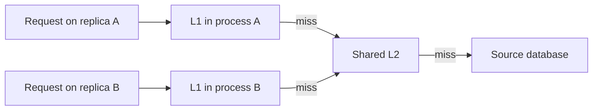

<div dir="ltr" align="left">

[فارسی](README.md) | **English**

# 01.3 — Multi-level Caching and Version Coordination

**Sources reviewed: 2026-11-10** · Prerequisites: [cache patterns](../02-cache-patterns/README.en.md), multiple application instances, and the difference between local memory and a networked cache.

## Learning objective and definition

After this lesson, you can design an `L1 → L2 → source` path, calculate each hit rate with its correct denominator, and explain why clearing a shared cache does not clear every process’s memory. **Multi-level caching** means consecutive reuse locations with different speed, size, and sharing scope. Here, L1 is local application memory and L2 is a shared network cache; these names do not refer to CPU hardware caches.

HTTP and CDN layers were introduced in the [cache layers lesson](../01-cache-layers/README.en.md). This lesson focuses on local memory across application replicas and a shared data cache, not CDN placement.

## Basic terms

A **replica** is a separate instance of the application with its own local memory. Here, **L1** is that instance’s memory and **L2** is a shared network cache; deleting an L2 value does not automatically update replica memory. TTL is the reuse period allowed by the entry’s contract and must be compared with the remaining lifetime of the version.

## Mental model and read steps

<div dir="ltr" align="left">



</div>

1. After access control, the application checks the L1 entry together with its version and freshness deadline.
2. On an L1 miss, it checks L2; on an L2 hit, it moves the data to L1 with its **remaining lifetime**.
3. If L2 also misses, it loads from the source within a time budget and concurrency limit, then fills the appropriate layers.
4. When the source changes, invalidate or update both L2 and all related L1 copies; commit ordering and in-flight fills matter too.

L1 can remove a network call on a hit. In return, every replica has its own copy and memory cost; more replicas duplicate the same data. [Amazon’s operational discussion of local and external caches](https://aws.amazon.com/builders-library/caching-challenges-and-strategies/) points to cross-server inconsistency and local cold starts; measure these costs before adding another layer.

## Trade-offs and scope selection

| Choice | Possible benefit | Cost/condition |
| --- | --- | --- |
| L2 only | One shared place for reuse across replicas | Every read still makes a network call |
| Small L1 + L2 | Fewer repeated calls to L2 for hot data | Duplicated memory, invalidation, and local versions |
| Short-lived L1 without messages | Simpler implementation for data that tolerates staleness | Accept a staleness window; this is not strong coherence |
| L1 with invalidation messages | Faster reaction to change when healthy | Message delay/loss and races with fills must be handled |

For a unique result on every request, L1 only adds storage cost. For data that must reflect changes immediately, removing the local layer may be better than adding a coordination protocol. Measure hit ratio with data age and p95/p99; a stale hit is not product success.

## Worked example: conditional hits and real lifetime

**Educational model, not a company result:** Out of 1,000 requests, L1 hits 800. Of the remaining 200, L2 hits 150. Thus 50 reads reach the source.

<div dir="ltr" align="left">

```text
L1 hit ratio                  = 800 / 1000 = 0.80
L2 conditional hit ratio      = 150 / 200  = 0.75
Overall cache hit ratio       = (800 + 150) / 1000 = 0.95
Source request fraction       = (1 - 0.80) * (1 - 0.75) = 0.05
```

</div>

Do not add 80% and 75%; their denominators differ. This model describes ordinary reads without retries, extra refreshes, coalescing, or errors. In a real system, also count source queries directly; cache miss rate is not always the query rate.

Now suppose an entry was loaded from the source at time 0 with `validUntil=60`. Replica B reads it from L2 at second 55. If L1 receives a fresh 60-second TTL, the data can stay locally until second 115, although the model’s budget was 60 seconds. A sample rule is:

<div dir="ltr" align="left">

```text
remaining = entry.validUntil - now
if remaining <= 0:
    doNotPromoteToL1()
else:
    localTtl = min(configuredL1Ttl, remaining)
    putL1(entry.value, entry.version, localTtl)
```

</div>

In a real implementation, absolute times across machines require clock synchronization and a safety margin; alternatively, propagate remaining lifetime while accounting for transfer time. Cache expiry alone does not prove the age of data in the database: a read replica may lag. The rule only prevents this example’s lifetime from being extended unintentionally as it moves between layers.

## Invalidation across replicas and disconnection

After a source update, deleting L2 does not notify A and B automatically. One option is to publish an event such as `product:42 changed to version 8` and clear all L1 copies. Redis Pub/Sub delivery is **at-most-once**; a subscriber disconnected when the message is sent does not receive it later. Therefore, ordinary Pub/Sub does not guarantee that every invalidation is received. [Official delivery-semantics documentation](https://redis.io/docs/latest/develop/pubsub/#delivery-semantics).

For a design that permits bounded staleness, define a fallback TTL, clear L1 on reconnect, and detect communication gaps. Replayable delivery needs a system with retention, a cursor, and recovery; changing the broker name is not enough. Even if the message arrives, an old in-flight fill may finish afterward. A generation/version and fill-publication control must prevent an old version from returning, or the window must be explicitly accepted.

## Exercise and worked solution

Without tools, make tables for `L1-A`, `L1-B`, and `L2`:

1. Fill all with version 7; A and B each read.
2. Change the source to version 8, clear L2, and clear only L1-A.
3. Read once on A and once on B. Then expire L1-B and read again.
4. Add an invalidation message but assume B is disconnected when it is sent; on reconnect, clear its L1 first.
5. Recalculate the hit example with L1 equal to 600 of 1,000 and L2 equal to 320 of 400.

**Expected:** At step 2, B may still return version 7; a load balancer can move the user between versions. Flushing on reconnect removes uncertain local reuse but causes warm-up load. In step 5, overall hit ratio is 92% and 80 reads reach the source. This exercise does not prove linearizable coherence.

### Step-by-step solution

After L2 and only `L1-A` are cleared, A and B can behave differently: A reaches the source/new version, while B can still return version 7 from its own memory. If B missed the invalidation message while disconnected, the disagreement persists; flushing on reconnect removes the uncertain copy but creates cold misses. In the revised calculation, `L1=600/1000=60%`, and `L2=320/400=80%` of L1 misses. Therefore the source receives `400×(1−0.8)=80` requests, or 8% of all requests, and the overall cache hit ratio is 92%. At `t=55`, only five seconds remain in the 60-second deadline, so promotion to L1 must have a TTL of at most five seconds.

## Public evidence: local cache assisted by Redis

> **Official operational documentation, not a benchmark:** [Redis client-side caching](https://redis.io/docs/latest/develop/clients/client-side-caching/) describes a real design in which the server tracks keys read by a client and sends invalidations when they change; the client drops the invalid entry. The “client” may be a library inside a backend, not a user’s browser. This illustrates L1 near the consumer; it does not invalidate SQL-to-Redis data or guarantee every concurrency case in your application.

Before enabling it, check the Redis version, protocol, library, and connection-pool behavior against the corresponding version’s documentation; support for a command alone does not mean full client-side caching support.

## Failures and operational signals

| Failure | Signal | What to inspect |
| --- | --- | --- |
| Old data returns from one replica | Response versions differ across requests | Record version and replica ID without sensitive data |
| Unbounded L1 size | Heap growth, GC pressure, or OOM | Entry count/size, memory limit, local eviction |
| All replicas roll out together | Miss spike and L2/source traffic | Staged rollout, cold-start capacity, coalescing |
| Promotion extends lifetime | Data age exceeds product budget | Original age metadata and remaining lifetime |
| Lost invalidation | Persistent version mismatch after reconnect | Message gap, flush, and recovery path |

## Operational checklist

- [ ] There is a measurable reason to add L1.
- [ ] L1 and L2 each have size caps, eviction policy, and TTL.
- [ ] Hit ratios use the correct separate denominators, and actual source access is reported.
- [ ] Version and lifetime are not silently extended when moving between layers.
- [ ] All replicas and writers are covered by invalidation design.
- [ ] Disconnection, reconnect, and an old fill concurrent with invalidation are reviewed.
- [ ] Cold starts and L2 loss do not become an unbounded source burst.
- [ ] Data age/version are sampled alongside latency.

## Quiz

1. Which locations do L1 and L2 mean in this lesson?
2. Why does deleting an L2 key not necessarily delete `L1-B`?
3. If L1 hits 60% and conditional L2 hits 80%, what percentage of requests reach the source?
4. Why might promoting an entry at second 55 with a fresh TTL of 60 be wrong?
5. Does ordinary Redis Pub/Sub replay a message missed during disconnection?
6. Does a shorter L1 TTL guarantee that no stale response can occur?

### Explained answers

1. Local memory of each process and a shared network cache; these names are not CPU-cache levels in this text.
2. Process B has separate memory; without a message, expiry, or other contract it does not know that L2 was cleared.
3. `0.40 × 0.20 = 0.08`, or 8%; overall hit ratio is 92%. L2 sees only requests that missed L1.
4. Only five seconds remain in the entry’s lifetime; a new TTL can extend it to second 115. Use remaining lifetime and the L1 cap.
5. No; delivery is at-most-once. Use flush, TTL, or replay/recovery for uncertain copies.
6. No; it only reduces reuse duration under stated assumptions. A lagging source, old fill, or delayed invalidation can still matter.

## Summary

L1 is worthwhile only when the cost of accessing L2 is measurable and freshness requirements permit local copies. Calculate hit rates with the correct conditional denominator, do not extend lifetime during promotion, and include lost messages and cold starts in source-capacity planning.

## Optional references and further reading

All paths and calculations are explained on this page. The sources below are optional for deeper study and implementation-specific behavior.

- English, primary product documentation: [Redis client-side caching](https://redis.io/docs/latest/develop/clients/client-side-caching/), for tracking, invalidation, disconnection, and client compatibility.
- English, primary command documentation: [Redis CLIENT TRACKING](https://redis.io/docs/latest/commands/client-tracking/), for server-assisted invalidation behavior.
- English, delivery contract: [Redis Pub/Sub](https://redis.io/docs/latest/develop/pubsub/), for its at-most-once limitation.
- English, operational case: [Amazon caching challenges](https://aws.amazon.com/builders-library/caching-challenges-and-strategies/), local/external caches, versions, and cold starts.
- English, official architecture guidance: [Azure caching best practices](https://learn.microsoft.com/en-us/azure/architecture/best-practices/caching), for choosing shared/local cache scope; this is vendor-specific design guidance, not a consistency guarantee for Redis or another product.
- Persian, related background: [Net Paradis: Redis, cache patterns, and expiry](https://netparadis.com/redis-data-types-caching-strategy/), for shared cache and TTL examples using Node.js. It is not a complete guide to the L1/L2 disconnection protocol; no Persian source covering every loss-and-fill race was found during review. This page and official Redis documentation cover that gap.

[Chapter contents](../README.en.md) · [Course contents](../../README.en.md) · [Previous: Cache patterns](../02-cache-patterns/README.en.md) · [Next: Invalidation and freshness](../04-invalidation-and-freshness/README.en.md) · [Related: Load balancing](../../05-load-balancing-and-scaling/02-load-balancing/README.en.md)

</div>
