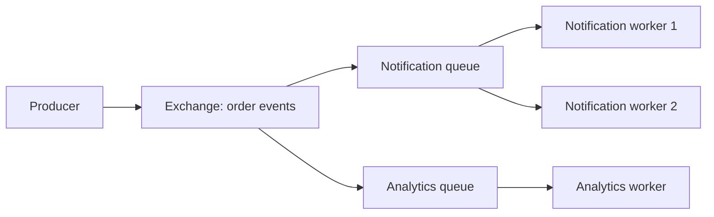

<div dir="ltr" align="left">

[فارسی](README.md) | **English**

# 3.2 — Message Brokers

A Message Broker is an intermediary that receives, routes, and delivers messages between producers and consumers. A message may command work or report an event that occurred. A Broker enables temporal separation and flow control; final outcomes and business rules still belong to the application.

**Sources reviewed: <span dir="ltr">2026-11-10</span>.** The concepts are vendor-independent; this lesson’s Exchange, Ack, and Prefetch examples use RabbitMQ and AMQP 0-9-1. Do not generalize these behaviors to every Broker and protocol without checking.

## Terms used in this lesson

A **Producer** publishes a message; a **Broker** accepts it according to routing and retention policy; a **Consumer** receives and processes it. An **Ack** is a protocol-level acknowledgement of receipt/disposition; when it is sent matters. Here, **idempotent** means processing the same ID again does not create a second local effect.

## Learning outcomes

- Explain the difference between a Work Queue, publication to multiple subscribers, and a replayable Log.
- Separate the boundary of Publish, Broker confirmation, delivery, and completed processing.
- Analyze duplicates, ordering, idempotency, and retries through a failure example.
- Apply backpressure both at producer intake and Worker consumption.
- Decide when Broker operations are worth their cost versus direct calls or a Job Store.

## Mental model: boundaries and patterns

In direct communication, the receiver usually needs to be available during the request. A Broker can retain a message according to policy so a consumer processes it later; this separation increases the need for message contracts and observability. If the producer immediately waits for the consumer’s final response, the latency-sensitive path still depends on that processing; merely routing through a Broker does not shorten it.

| Pattern | Work division | Suitable for | Cost/limit |
| --- | --- | --- | --- |
| Work Queue | Several Workers compete on one queue; each delivery goes to one consumer | Distributing independent tasks | Redelivery after failure and completion order |
| Pub/Sub with separate queues | Each service has its own queue/subscription | Notifying analytics and notification handlers independently | Separate capacity, failure, and delay for each subscriber |
| Log with offset and retention | Reader stores its read position | Replay and event streams | Managing lag, retention, and ordering contract |

A shared queue for two independent services usually distributes messages between them; both do not necessarily see every event. For independent reactions, create a separate queue/subscription per responsibility. RabbitMQ also has Streams in addition to Queues; a product’s name alone does not identify its consumption or replay model. [Official Queues documentation](https://www.rabbitmq.com/docs/queues) discusses structures and the effects of priority and requeue on ordering.



In RabbitMQ, this path is defined with Binding and Routing Key. A missing or incorrect Binding can leave a message without a destination. If the contract requires a message to reach at least one queue, inspect mandatory routing and returned messages; do not confuse receiving Publisher Confirm with correct routing. [RabbitMQ Reliability guide](https://www.rabbitmq.com/docs/reliability) describes this case.

## Delivery, acknowledgements, and guarantees

Record three separate events: Broker acceptance, delivery to a consumer, and successful recording of the consumer’s effect. **Publisher Confirm** concerns producer/Broker interaction; **Consumer Ack** concerns Broker/consumer interaction. The first does not say that processing succeeded. With manual acknowledgement, send Ack after the defined success point; Ack too early and then losing the Worker can delete work that was not completed. [Official Confirms and Acknowledgements documentation](https://www.rabbitmq.com/docs/confirms) describes the distinction.

| Guarantee | Meaning at the defined boundary | Application implication |
| --- | --- | --- |
| At-most-once | A message may not arrive, but it is not redelivered under that contract | Consider only for data that can be lost |
| At-least-once | Given durability, recovery, and retention policy, an unacknowledged message may be delivered again | Control duplicate effects |
| Exactly-once within a scope | A tool may suppress repetition within a defined boundary | Analyze external effects outside that boundary separately |

“Exactly-once” alone does not guarantee “one email, one charge, and one write in every system.” If a Worker commits an effect and dies before Ack, the Broker does not know the effect completed. That gap explains the need for idempotency.

A durable queue, persistent message, replication, and Confirm policy are different parts of durability. Do not treat only durable=true as a promise that every message survives every failure. Review queue type, message persistence, confirmation, retention, and failover behavior in the [Queues guide](https://www.rabbitmq.com/docs/queues) and the selected version’s contract.

## Worked example: order-confirmed event

The following educational example is an event published after an order is recorded. Its event ID remains the same for all attempts to publish that event. correlation_id supports tracing and is not an idempotency key. A schema version lets consumers consciously reject or quarantine an unsupported message.

<div dir="ltr" align="left">

```json
{
  "event_id": "evt-204",
  "type": "order.confirmed",
  "schema_version": 1,
  "occurred_at": "2026-11-10T08:00:00Z",
  "correlation_id": "request-91",
  "order_id": "order-204",
  "order_version": 3
}
```

```text
consume(event):
    validate_supported_schema(event)
    transaction:
        inserted = insert_processed_id_if_absent(
            consumer="analytics-v1", event_id=event.event_id)
        if inserted:
            apply_local_analytics_update(event)
        commit
    ack_delivery()
```

</div>

The processed-ID table needs a unique constraint on consumer/event and must share a transaction with the local effect. Otherwise, “ID recorded but effect not applied” or a repeated effect can occur. Retain IDs for an interval compatible with replay horizon and possible delays; deleting them too early permits an effect to repeat. This local transaction does not make email or an external API atomic; use the destination’s idempotency key or reconcile an unknown outcome.

Follow the failure sequence:

1. Producer Publishes, Broker accepts, but Confirm is lost in the network. Producer does not know whether the message arrived and may resend with the same event_id.
2. Consumer Commits and dies before Ack. Message is redelivered; the unique insert does not happen on the second run, so the effect is not repeated, then Ack is sent.
3. If Ack had been sent before Commit, a Worker crash could lose the effect. Ordering the boundaries creates the actual contract.

[RabbitMQ Reliability Guide](https://www.rabbitmq.com/docs/reliability) explicitly describes possible duplicates during recovery and the need for an idempotent consumer. This example covers only a transactional local effect. For the gap between recording an order and publishing its event, see the [Outbox explanation in the Background Jobs lesson](../01-background-jobs/README.en.md).

## Backpressure, retries, and ordering

**Prefetch** limits the number of delivered but unacknowledged messages. For one RabbitMQ consumer with a limit of 10, after ten unacknowledged deliveries the Broker waits for capacity to be released before delivering more; zero means unlimited. Do not confuse this with actual execution concurrency: a one-thread Worker may hold ten messages in memory but run only one. [Consumer Prefetch documentation](https://www.rabbitmq.com/docs/consumer-prefetch) explains scope per consumer; check channel settings and version.

Prefetch only limits delivery pressure on the consumer; it does not prevent unlimited intake into the Broker. Also define message/byte caps, producer rate limits, Outbox capacity, and what to reject or pause. On a full queue, Drop, Reject, or Dead-letter behavior must match the message’s importance and be observable. More disk merely postpones saturation unless completion capacity also reaches intake.

For temporary errors, define delayed retries, backoff, jitter, and a maximum budget. Immediate requeue of a bad message can create a hot loop that consumes CPU and network. Permanent schema/data errors can go to a quarantine such as a **Dead-letter Queue (DLQ)** if configured. A DLQ is not success: it needs an owner, alert, cause, and controlled replay procedure. Check its transfer and durability behavior for the chosen Broker and queue type.

Queue arrival order is not effect-completion order. Two Workers may complete order version 4 before version 3; requeue and priority also change observed order. If per-order ordering matters, partition/serialize by order key and use order_version to detect stale messages. This limits parallelism for one hot key. Global ordering usually costs more than ordering per entity.

## When is a Broker appropriate?

A Broker is useful when producers and consumers must be independent at runtime or deployment, several independent handlers need the same event, or short-term intake variability needs buffering. Its costs include service operations, capacity and storage, schema contracts, delivery failures, security, and multi-stage debugging. A persistent Job Store may suffice for one simple in-application task. For a response required immediately, a direct request with a clear timeout may be simpler. Choose based on requirements and measurement.

## Exercise and worked solution

For message evt-204, make a table with “processed history,” “order count,” and “Ack sent.” Start with empty/zero values. Stop the consumer just after the example’s Commit and before Ack; then redeliver the same message.

**Expected:** After the first attempt, one ID is recorded and count is 1, but there is no Ack. On the second attempt, the unique constraint prevents a second effect; the count remains 1 and Ack is sent. If ID recording and count update use separate transactions, find the interruption point where data is lost or counted twice.

Now assume one consumer and Prefetch 2. Send five messages and hold Ack. At most two are delivered/unacknowledged and three remain ready; after Acking one, one more can be delivered. This observation assumes the push-delivery/manual-ack model in the example. A low ready-message count alone does not prove health without checking unacknowledged messages and age.

### Step-by-step solution

After the first attempt commits, the table is: processed = {evt-204}, count = 1, Ack = no. On redelivery, the unique constraint makes inserted=false; the count stays 1 and Ack=yes is sent after the local transaction without repeating the effect. If processed history and count were in separate transactions, a crash after recording the ID but before incrementing loses the effect; a crash after incrementing but before recording the ID increments again. With Prefetch 2, five messages without Ack means two delivered and three ready. Ack one, then another is delivered; there are again two unacknowledged and two ready.

## Real evidence: Slack’s job queue

In [Scaling Slack’s Job Queue](https://slack.engineering/scaling-slacks-job-queue/), first published in 2017 and updated in 2020, Slack describes Redis memory exhaustion and blocked intake when Enqueue outpaced Dequeue. The team placed Kafka before Redis and controlled relay speed to separate work execution pressure from acceptance. The account also describes a historical Leader-confirmation choice that accepted the risk of losing some jobs if failure happened before replication in exchange for lower latency.

**Teaching takeaway:** a Broker’s name alone does not determine durability; Ack policy, storage, and capacity at each stage must match business meaning. Slack’s historical choice is not a recommendation for financial orders. The evt-204 example and exercise are not Slack production data.

## Common errors, signals, and review

| Error | Signal | Practical inspection |
| --- | --- | --- |
| Wrong Binding | Returned/unrouted message; gap between Publish and consumption | Routing contract and Return alert |
| Treating Confirm as business success | Producer succeeds but result is missing | Result status and consumer Ack |
| Unbounded Prefetch or concurrency | RAM and unacknowledged messages rise; consumer slows | Cap delivery and execution separately |
| Requeue loop | Delivery rate high, completion low | Delayed retry and quarantine |
| Incompatible schema | DLQ or Reject after deployment | Schema compatibility and staged release |
| One queue shared by independent services | Each service sees only part of the messages | Separate subscription for each responsibility |

## Operational checklist

- [ ] Message meaning, schema, owner, and compatibility policy are defined.
- [ ] Unknown/failed Publish, Confirm, and unrouted-message policy are documented.
- [ ] Ack follows the required effect; duplicates/concurrent processing do not corrupt it.
- [ ] Message durability, queue type, replication, and retention limits match the need.
- [ ] Publish/delivery/completion rates, Ready, Unacked, Age/Lag, and disk are visible.
- [ ] Intake capacity, Prefetch, and Worker concurrency are each bounded.
- [ ] Retry has a budget; DLQ has an owner, alert, and safe replay procedure.
- [ ] Network loss and Worker death on either side of Commit/Ack are analyzed.
- [ ] Required ordering is clear at the entity level and preserved when Consumers scale.
- [ ] Publish/Consume access is least-privileged; messages carry only necessary sensitive data.

## Quiz

1. If notification and analytics must both receive every event, is one queue with two consumers enough?
2. What exactly does Publisher Confirm not tell us?
3. How can a successful Commit followed by a disconnect before Ack cause a duplicate, and how does this example contain its effect?
4. Does Prefetch 10 mean ten tasks run concurrently? Does it prevent the Broker queue from growing?
5. Why is durable=true alone not a complete message-durability guarantee?
6. With two Workers, does FIFO queue order guarantee version 3 finishes before version 4?
7. Should a message with an unsupported schema be immediately requeued repeatedly?

### Explained answers

1. No. Consumers in a Work Queue compete to divide work. Independent subscribers that each need every event require their own queue/subscription.
2. It does not tell us consumer processing or final business success. Confirm covers the producer/Broker boundary and is separate from Consumer Ack.
3. The Broker did not receive Ack and may redeliver. The unique constraint plus local effect in one transaction prevents the second effect; the repeated delivery is then Acked.
4. No to both. Prefetch caps unacknowledged deliveries within its scope; Worker execution concurrency is separate, and Broker intake needs its own cap.
5. Queue durability, message persistence, replication, Publish confirmation, and retention differ. Inspect the full settings and failure model, not a single flag.
6. No. Worker runtimes can differ and completion order can change. Per-order order requires serialization/partitioning and version checks.
7. A schema incompatibility is usually not fixed by the same binary and message. Quarantine with cause/alert, fix compatibility, then replay under control; immediate requeue creates an expensive loop.

## Summary

A Broker provides temporal separation and routing, but redelivery, duplicate effects, order, and durability remain application contracts. Separate Confirm, Consumer Ack, and business success; bound intake, Prefetch, Workers, and dependencies, and define quarantine/replay for each message.

## Optional references and further reading

This page defines the Producer-to-Ack path, failure handling, and exercise. The links below are optional product references and real-world experience.

- Persian, practical tutorial: [Working with RabbitMQ — Ali Sabet](https://alixsabet.com/fa/posts/2025/02/rabbitmq/), Producer/Exchange/Consumer vocabulary and flow; use official documentation for operational guarantees.
- Persian, service overview: [Managed RabbitMQ — Sakoocloud](https://sakoocloud.ir/databases/rabbitmq/), an introduction to managed queue use. It is commercial information, not performance evidence or a provider requirement.
- English, first-party reliability docs: [RabbitMQ Reliability](https://www.rabbitmq.com/docs/reliability), redelivery, recovery, idempotency, and routing.
- English, first-party protocol docs: [Confirms and Consumer Acknowledgements](https://www.rabbitmq.com/docs/confirms), acknowledgement boundaries and failure behavior.
- English, first-party protocol docs: [Consumer Prefetch](https://www.rabbitmq.com/docs/consumer-prefetch), delivery limits and scope.
- English, first-party product docs: [RabbitMQ Queues](https://www.rabbitmq.com/docs/queues), queue types, durability, and ordering.
- English, first-hand engineering: [Scaling Slack’s Job Queue](https://slack.engineering/scaling-slacks-job-queue/), capacity choices, flow control, and delivery trade-offs in a real system.

[Previous: Background jobs](../01-background-jobs/README.en.md) · [Chapter contents](../README.en.md) · [Course contents](../../README.en.md) · [Related: Timeouts and retries](../../06-code-optimization/07-timeouts-and-retries/README.en.md) · [Related: Monitoring](../../07-monitoring-and-logging/01-metrics-logs-and-traces/README.en.md) · [Next chapter: Databases](../../04-databases/README.en.md)

</div>
