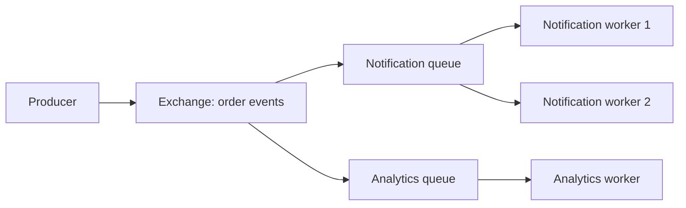

<div dir="rtl" align="right">

# ۳.۲ — واسطه‌های پیام | Message Brokers

**زبان:** فارسی · [English version](README.en.md)


Message Broker واسطه‌ای برای دریافت، مسیریابی و تحویل پیام میان تولیدکننده و مصرف‌کننده است. پیام می‌تواند دستور انجام کار یا خبر وقوع یک رویداد باشد. Broker امکان جدایی زمانی و کنترل جریان را فراهم می‌کند؛ ضمانت نتیجه نهایی و قواعد کسب‌وکار همچنان به برنامه وابسته‌اند.

**تاریخ بررسی منابع: <span dir="ltr">2026-11-10</span>.** مفاهیم عمومی مستقل از فروشنده‌اند؛ جزئیات `Exchange`، `Ack` و `Prefetch` در این صفحه با RabbitMQ و AMQP 0-9-1 مثال زده می‌شوند. این رفتارها را بدون بررسی به همه Brokerها و پروتکل‌ها تعمیم ندهید.

## واژه‌های لازم در همین درس

**Producer** پیام را منتشر می‌کند؛ **Broker** آن را طبق مسیر و سیاست نگهداری می‌پذیرد؛ **Consumer** آن را تحویل می‌گیرد و اثر موردنظر را اجرا می‌کند. **Ack** اعلام دریافت/اتمام در قرارداد پروتکل است و زمان ارسالش مهم است. واژهٔ **Idempotent** در این درس یعنی پردازش دوبارهٔ همان شناسه اثر محلی دوم نسازد.

## خروجی‌های یادگیری

- تفاوت Work Queue، انتشار برای چند مشترک و Log قابل بازخوانی را توضیح می‌دهید.
- مرز Publish، تأیید Broker، تحویل و اتمام پردازش را از هم جدا می‌کنید.
- پیام تکراری، ترتیب، Idempotency و Retry را با مثال خرابی تحلیل می‌کنید.
- Backpressure را هم در پذیرش تولیدکننده و هم در مصرف Worker اعمال می‌کنید.
- درباره هزینه عملیاتی Broker در برابر فراخوانی مستقیم یا Job Store تصمیم می‌گیرید.

## مدل ذهنی: مرزها و الگوها

در ارتباط مستقیم، گیرنده معمولاً باید هنگام درخواست در دسترس باشد. Broker می‌تواند پیام را طبق سیاست نگهداری حفظ کند تا مصرف‌کننده بعداً پردازش کند؛ این جدایی، نیاز به قرارداد داده و مشاهده‌پذیری را بیشتر می‌کند. اگر تولیدکننده بلافاصله منتظر پاسخ نهایی مصرف‌کننده شود، مسیر حساس به تأخیر هنوز به آن پردازش وابسته است؛ صرف عبور از Broker آن را کوتاه نمی‌کند.

| الگو | تقسیم کار | مناسب برای | هزینه/محدودیت |
| --- | --- | --- | --- |
| Work Queue | چند Worker روی یک صف؛ هر تحویل به یک مصرف‌کننده | تقسیم اجرای کارهای مستقل | تکرار پس از خرابی و ترتیب تکمیل |
| Pub/Sub با صف‌های مجزا | هر سرویس صف/اشتراک خودش را دارد | اطلاع‌رسانی به اعلان و تحلیل هم‌زمان | ظرفیت، خطا و تأخیر جدا برای هر مشترک |
| Log با Offset و Retention | خواننده موقعیت خواندن را نگه می‌دارد | بازخوانی و جریان رویداد | مدیریت Lag، نگهداری و قرارداد ترتیب |

یک صف مشترک برای دو سرویس مستقل، معمولاً پیام را بین آن‌ها تقسیم می‌کند؛ هر دو الزاماً همه رویدادها را نمی‌بینند. برای دو واکنش مستقل، صف/اشتراک جدا بسازید. RabbitMQ علاوه بر Queue، ساختار Stream نیز دارد؛ انتخاب نام محصول به تنهایی مدل مصرف و بازخوانی را مشخص نمی‌کند. [مستند رسمی Queues](https://www.rabbitmq.com/docs/queues) تفاوت ساختارها و اثر اولویت و Requeue بر ترتیب را معرفی می‌کند.

</div>



<div dir="rtl" align="right">

در RabbitMQ این مسیر با Binding و Routing Key تعریف می‌شود. نبود Binding صحیح می‌تواند پیام را بی‌مقصد کند. برای جریان حساس به رسیدن پیام به حداقل یک صف، رفتار `mandatory` و پیام برگشتی را بررسی کنید؛ دریافت Publisher Confirm را با درست بودن مقصد اشتباه نگیرید. [راهنمای Reliability در RabbitMQ](https://www.rabbitmq.com/docs/reliability) جزئیات این حالت را شرح می‌دهد.

## تحویل، تأیید و ضمانت‌ها

سه نقطه را جدا ثبت کنید: پذیرش پیام نزد Broker، تحویل به مصرف‌کننده، و ثبت اثر موفق مصرف‌کننده. **Publisher Confirm** درباره تعامل تولیدکننده با Broker است؛ **Consumer Ack** درباره تعامل Broker با مصرف‌کننده. اولی نشان نمی‌دهد کار نهایی موفق شده است. در تأیید دستی، Ack را پس از نقطه موفقیت تعریف‌شده بفرستید؛ Ack زودهنگام و سپس مرگ Worker می‌تواند به حذف کاری برسد که کامل نشده است. این جدایی در [مستند رسمی Confirms و Acknowledgements](https://www.rabbitmq.com/docs/confirms) آمده است.

| ضمانت | معنی در مرز تعریف‌شده | پیامد برای برنامه |
| --- | --- | --- |
| At-most-once | پیام ممکن است نرسد، اما تحویل مجدد در همان قرارداد انجام نمی‌شود | برای داده قابل‌ازدست‌رفتن قابل بررسی است |
| At-least-once | با فرض رعایت دوام، بازیابی و سیاست نگهداری، تحویل مجدد برای پیام تأییدنشده ممکن است | اثر تکراری را باید کنترل کرد |
| Exactly-once در یک محدوده | یک ابزار ممکن است در محدوده مشخص خود تکرار را مهار کند | اثر بیرونی خارج از آن محدوده را جدا تحلیل کنید |

عبارت Exactly-once به تنهایی تضمین «یک ایمیل، یک برداشت وجه و یک نوشتن در هر سیستم» نیست. اگر Worker اثر را Commit کند و پیش از Ack قطع شود، Broker از اتمام اثر خبر ندارد. همین شکاف، نیاز به Idempotency را توضیح می‌دهد.

Queue پایدار، Persistent بودن پیام، Replication و سیاست Confirm اجزای متفاوت دوام‌اند. فقط `durable=true` را به معنی ماندگاری همه پیام‌ها در تمام خرابی‌ها نگیرید؛ نوع Queue، پیام، تأیید، نگهداری و رفتار Failover را با [راهنمای Queues](https://www.rabbitmq.com/docs/queues) و قرارداد نسخه انتخابی مرور کنید.

## مثال حل‌شده: رویداد تأیید سفارش

مثال آموزشی زیر رویدادی است که پس از ثبت سفارش منتشر می‌شود. شناسه رویداد برای همه تلاش‌های انتشار همان رویداد ثابت می‌ماند. `correlation_id` برای ردیابی است و جای شناسه تکرارپذیری را نمی‌گیرد. شماره نسخه Schema به مصرف‌کننده کمک می‌کند پیام ناشناخته را آگاهانه رد یا قرنطینه کند.

</div>

```json
{
  "event_id": "evt-204",
  "type": "order.confirmed",
  "schema_version": 1,
  "occurred_at": "2026-11-10T08:00:00Z",
  "correlation_id": "request-91",
  "order_id": "order-204",
  "order_version": 3
}
```

```text
consume(event):
    validate_supported_schema(event)
    transaction:
        inserted = insert_processed_id_if_absent(
            consumer="analytics-v1", event_id=event.event_id)
        if inserted:
            apply_local_analytics_update(event)
        commit
    ack_delivery()
```

<div dir="rtl" align="right">

جدول شناسه‌های پردازش‌شده باید قید یکتا روی زوج مصرف‌کننده و رویداد داشته باشد و ثبت آن همراه با اثر محلی در یک تراکنش باشد. در غیر این صورت، «شناسه ثبت شد ولی اثر انجام نشد» یا اثر دوباره رخ می‌دهد. نگهداری شناسه‌ها باید با افق Replay و تأخیر محتمل هماهنگ شود؛ حذف زودهنگام، راه تکرار اثر را باز می‌کند. برای ایمیل یا API بیرونی، این تراکنش محلی اثر مقصد را اتمیک نمی‌کند؛ کلید Idempotency مقصد یا فرایند بازیابی نتیجه نامعلوم لازم است.

اکنون خطا را مرحله‌ای ببینید:

۱. تولیدکننده Publish می‌کند، Broker می‌پذیرد، ولی Confirm در شبکه گم می‌شود. تولیدکننده نمی‌داند پیام رسیده یا نه و ممکن است با همان `event_id` دوباره بفرستد.

۲. مصرف‌کننده Commit می‌کند و پیش از Ack می‌میرد. پیام دوباره تحویل می‌شود؛ درج یکتا در اجرای دوم انجام نمی‌شود، اثر تکرار نمی‌شود و سپس Ack فرستاده می‌شود.

۳. اگر Ack پیش از Commit فرستاده شده بود، مرگ Worker می‌توانست اثر را از بین ببرد. پس ترتیب مرزها، قرارداد واقعی را می‌سازد.

[RabbitMQ Reliability Guide](https://www.rabbitmq.com/docs/reliability) احتمال تکرار در بازیابی و نیاز به مصرف‌کننده Idempotent را صریح توضیح می‌دهد. این مثال فقط اثر محلیِ تراکنشی را پوشش می‌دهد. برای شکاف ثبت سفارش و انتشار رویداد، [توضیح Outbox در درس کارهای پس‌زمینه](../01-background-jobs/README.md) را ببینید.

## Backpressure، Retry و ترتیب

**Prefetch** تعداد پیام‌های تحویل‌داده‌شده ولی Ackنشده را محدود می‌کند. برای یک مصرف‌کننده RabbitMQ با سقف ۱۰، پس از ۱۰ پیام Ackنشده تحویل تازه منتظر آزاد شدن ظرفیت می‌ماند؛ مقدار صفر یعنی بی‌حد. این سقف را با هم‌زمانی اجرای واقعی اشتباه نگیرید: Worker با یک Thread ممکن است ۱۰ پیام در حافظه داشته باشد ولی یکی را اجرا کند. [مستند Consumer Prefetch](https://www.rabbitmq.com/docs/consumer-prefetch) Scope هر مصرف‌کننده را توضیح می‌دهد؛ تنظیمات Channel و نسخه را بررسی کنید.

Prefetch فقط فشار تحویل به مصرف‌کننده را محدود می‌کند؛ جلوی ورود نامحدود به Broker را نمی‌گیرد. سقف پیام/بایت، محدودیت نرخ Publish، ظرفیت Outbox و سیاست رد یا توقف پذیرش را در ورودی نیز مشخص کنید. در حالت پرشدن، رفتار Drop، Reject یا Dead-letter باید مطابق اهمیت پیام باشد و قابل مشاهده بماند. افزایش فضای دیسک تنها افق زمانی اشباع را عقب می‌برد، مگر ظرفیت تکمیل نیز به ورودی برسد.

برای خطای موقت، تلاش مجددِ با تأخیر، Backoff، Jitter و سقف بودجه تعریف کنید. Requeue فوریِ پیام خراب می‌تواند حلقه داغ بسازد و CPU و شبکه را مصرف کند. خطای Schema یا داده دائمی به محل قرنطینه مانند **Dead-letter Queue (DLQ)** می‌رود، اگر چنین مسیری پیکربندی شده باشد. DLQ موفقیت نیست: مالک، هشدار، علت و روش بازفرستادن کنترل‌شده لازم دارد. انتقال به DLQ و دوام آن نیز باید مطابق ابزار و نوع Queue بررسی شود.

ترتیب ورود به صف با ترتیب تکمیل اثرها یکی نیست. دو Worker می‌توانند نسخه ۴ سفارش را پیش از نسخه ۳ تمام کنند؛ Requeue و Priority نیز ترتیب مشاهده را تغییر می‌دهند. اگر ترتیب هر سفارش مهم است، از کلید سفارش برای تقسیم‌بندی/سری‌سازی و از `order_version` برای تشخیص پیام کهنه استفاده کنید. این کار موازی‌سازی یک کلید داغ را محدود می‌کند. تضمین ترتیب سراسری معمولاً هزینه بیشتری از ترتیب برای هر موجودیت دارد.

## چه وقت Broker مناسب است؟

وقتی تولیدکننده و مصرف‌کننده باید مستقل در زمان اجرا یا استقرار باشند، چند واکنش مستقل به یک رویداد دارید، یا نوسان کوتاه‌مدت ورودی را می‌خواهید جذب کنید، Broker ارزش دارد. هزینه‌اش نگهداری سرویس، ظرفیت و ذخیره‌سازی، قرارداد Schema، خطای تحویل، امنیت و عیب‌یابی چندمرحله‌ای است. برای یک وظیفه ساده در همان برنامه، Job Store پایدار ممکن است کافی باشد. برای پاسخی که همین لحظه لازم است، درخواست مستقیم با Timeout روشن ممکن است ساده‌تر باشد. انتخاب را بر اساس نیاز و اندازه‌گیری انجام دهید.

## تمرین کوچک و راه‌حل نمونه

یک آزمایش کاغذی با پیام `evt-204` انجام دهید. جدول سه ستون «سابقه processed»، «عدد شمارش سفارش» و «Ack ارسال شد» بسازید. ابتدا همه را خالی/صفر بگیرید. مصرف‌کننده را درست پس از Commit مثال و پیش از Ack قطع کنید؛ سپس همان پیام را دوباره تحویل بدهید.

**انتظار:** پس از تلاش اول، یک شناسه ثبت و شمارش یک شده است، ولی Ack ندارید. در تلاش دوم، قید یکتا اجازه اثر دوباره نمی‌دهد؛ شمارش یک می‌ماند و Ack ارسال می‌شود. اگر ثبت شناسه و شمارش را در دو تراکنش جدا قرار دهید، نقطه قطع میان آن‌ها را پیدا کنید و نشان دهید چه داده‌ای گم یا دوباره محاسبه می‌شود.

اکنون با فرض یک مصرف‌کننده و Prefetch برابر ۲، پنج پیام بفرستید و Ack را نگه دارید. باید حداکثر دو پیام در حال تحویل/Ackنشده و سه پیام آماده باقی بماند؛ پس از Ack یکی، یک پیام دیگر تحویل می‌شود. این مشاهده مربوط به مدل Push و تأیید دستی این مثال است. تعداد پیام آماده پایین، بدون بررسی پیام‌های Ackنشده و Age، دلیل سلامت نیست.

## راه‌حل گام‌به‌گام تمرین

پس از Commit تلاش اول، جدول چنین است: `processed={evt-204}`, شمارش `1`، Ack=`خیر`. هنگام تحویل دوباره، قید یکتا `inserted=false` می‌دهد؛ شمارش همان `1` می‌ماند و پس از Commit بدون اثر دوباره Ack=`بله` می‌شود. اگر سابقهٔ processed و شمارش در دو تراکنش جدا باشند، قطع پس از ثبت سابقه و پیش از افزایش شمارش باعث گم‌شدن اثر می‌شود؛ قطع پس از افزایش شمارش و پیش از سابقه باعث دوباره‌شماری. برای Prefetch 2، پنج پیام بدون Ack یعنی دو پیام تحویل‌شده و سه آماده؛ پس از Ack یکی، یک پیام سوم تحویل می‌شود و دوباره دو پیام Ackنشده و دو پیام آماده خواهیم داشت.

## شواهد واقعی: صف کار Slack

Slack در [Scaling Slack’s Job Queue](https://slack.engineering/scaling-slacks-job-queue/) با انتشار اولیه ۲۰۱۷ و به‌روزرسانی ۲۰۲۰ توضیح می‌دهد وقتی نرخ Enqueue از Dequeue بیشتر می‌شد، حافظه Redis می‌توانست تمام شود و پذیرش کار مختل شود. تیم Kafka را پیش از Redis اضافه کرد و سرعت Relay را کنترل کرد تا فشار اجرای کار از پذیرش جدا شود. روایت همچنین انتخاب تاریخی تأیید Leader را توضیح می‌دهد که برای تأخیر کمتر، ریسک از دست رفتن بعضی کارها هنگام خرابی پیش از Replication را می‌پذیرفت.

**برداشت آموزشی:** نام Broker به تنهایی دوام را تعیین نمی‌کند؛ سیاست Ack، ذخیره‌سازی و ظرفیت هر مرحله باید با معنای کسب‌وکار هماهنگ باشد. این انتخاب تاریخی Slack توصیه‌ای برای سفارش مالی نیست. مثال `evt-204` و تمرین این صفحه داده Production Slack نیستند.

## خطاهای رایج، سیگنال‌ها و بازبینی

| خطا | سیگنال | بررسی عملی |
| --- | --- | --- |
| Binding اشتباه | پیام برگشتی/بدون مقصد، فاصله Publish و مصرف | قرارداد مسیریابی و هشدار Return |
| Confirm را موفقیت کسب‌وکار دانستن | تولیدکننده موفق، نتیجه غایب | وضعیت نتیجه و Ack مصرف‌کننده |
| Prefetch یا هم‌زمانی نامحدود | RAM و Ackنشده‌ها زیاد، Consumer کند | سقف تحویل و سقف اجرا |
| حلقه Requeue | نرخ تحویل بالا، تکمیل پایین | Retry با تأخیر و قرنطینه |
| Schema ناسازگار | DLQ یا Reject پس از استقرار | سازگاری نسخه و انتشار تدریجی |
| صف مشترک برای دو سرویس مستقل | هر سرویس تنها بخشی از پیام‌ها را دارد | اشتراک جدا برای هر مسئولیت |

## چک‌لیست عملیاتی

- [ ] معنای هر پیام، Schema، مالک و سیاست سازگاری تعریف شده است.
- [ ] سیاست Publish ناموفق/نامعلوم، Confirm و پیام بی‌مقصد مستند است.
- [ ] Ack پس از اثر موردنظر است و تکرار/اجرای هم‌زمان اثر را خراب نمی‌کند.
- [ ] دوام پیام، نوع Queue، Replication و محدودیت Retention با نیاز هماهنگ‌اند.
- [ ] نرخ Publish/تحویل/تکمیل، Ready، Unacked، Age/Lag و فضای دیسک دیده می‌شوند.
- [ ] ظرفیت پذیرش، Prefetch و هم‌زمانی Worker هر سه محدودند.
- [ ] Retry بودجه دارد؛ DLQ مالک، هشدار و روش Replay امن دارد.
- [ ] قطع شبکه و مرگ Worker در دو طرف Commit و Ack تحلیل شده‌اند.
- [ ] ترتیب موردنیاز در سطح موجودیت روشن است و با افزایش Consumer نقض نمی‌شود.
- [ ] دسترسی Publish/Consume حداقلی است؛ اطلاعات حساس فقط به اندازه نیاز در پیام قرار می‌گیرد.

## آزمون کوتاه

۱. اگر اعلان و تحلیل هر دو باید تمام رویدادها را بگیرند، یک صف با دو Consumer کافی است؟

۲. Publisher Confirm دقیقاً چه چیزی را به ما نمی‌گوید؟

۳. Commit موفق و قطع پیش از Ack چگونه به پیام تکراری می‌رسد و مثال چگونه اثر آن را مهار می‌کند؟

۴. آیا Prefetch برابر ۱۰ یعنی ۱۰ کار هم‌زمان اجرا می‌شوند؟ آیا جلوی رشد صف Broker را می‌گیرد؟

۵. چرا `durable=true` به تنهایی یک ضمانت کامل دوام پیام نیست؟

۶. با دو Worker، آیا FIFO بودن صف تضمین می‌کند نسخه ۳ پیش از نسخه ۴ تمام شود؟

۷. یک پیام با نسخه Schema پشتیبانی‌نشده را بارها فوری Requeue کنیم یا سیاست دیگری لازم است؟

<details>
<summary>پاسخ‌نامه توضیحی</summary>

۱. خیر. Consumerهای یک Work Queue برای تقسیم کار رقابت می‌کنند. برای دریافت مستقل تمام رویدادها، هر مسئولیت صف/اشتراک خودش را می‌خواهد.

۲. موفقیت پردازش مصرف‌کننده یا نتیجه نهایی کسب‌وکار را نمی‌گوید. Confirm مرز تولیدکننده و Broker را پوشش می‌دهد و از Consumer Ack جداست.

۳. Broker Ack دریافت نکرده و ممکن است پیام را بازتحویل دهد. قید یکتا همراه با اثر محلی در یک تراکنش، اجرای اثر دوم را متوقف می‌کند؛ سپس تحویل تکراری Ack می‌شود.

۴. خیر به هر دو. Prefetch سقف پیام Ackنشده در Scope مربوط است؛ هم‌زمانی اجرا را Worker تعیین می‌کند و ظرفیت ورودی Broker به محدودیت جدا نیاز دارد.

۵. دوام Queue، دوام خود پیام، Replication، تأیید انتشار و سیاست نگهداری متفاوت‌اند. باید مجموعه تنظیمات و سناریوی خرابی بررسی شود، نه فقط یک پرچم.

۶. خیر. زمان اجرای دو Worker می‌تواند متفاوت باشد و ترتیب تکمیل عوض شود. ترتیب هر سفارش به سری‌سازی/تقسیم‌بندی و بررسی نسخه نیاز دارد.

۷. خطای ناسازگاری غالباً با همان باینری و پیام درمان نمی‌شود. قرنطینه با علت، هشدار، اصلاح قرارداد و Replay کنترل‌شده مناسب‌تر است؛ Requeue فوری حلقه پرهزینه می‌سازد.

</details>

## جمع‌بندی

Broker جدایی زمانی و مسیریابی را فراهم می‌کند، اما تحویل دوباره، اثر تکراری، ترتیب و دوام قرارداد برنامه‌اند. Confirm، Consumer Ack و موفقیت کسب‌وکار را جدا کنید؛ ظرفیت ورودی، Prefetch، Worker و وابستگی را محدود کنید و برای هر پیام راه قرنطینه/Replay داشته باشید.

## منابع اختیاری و مرجع

این صفحه Producer تا Ack، خرابی و تمرین را تعریف می‌کند؛ منابع زیر برای مرجع محصول و مطالعهٔ تجربه‌های واقعی اختیاری‌اند.

- **فارسی، آموزش عملی:** [کار با RabbitMQ — علی ثابت](https://alixsabet.com/fa/posts/2025/02/rabbitmq/)؛ واژگان و جریان Producer، Exchange و Consumer. برای ضمانت‌های عملیاتی به مرجع رسمی رجوع کنید.
- **فارسی، معرفی خدمات و کاربردها:** [RabbitMQ مدیریت‌شده — سکو کلود](https://sakoocloud.ir/databases/rabbitmq/)؛ آشنایی با کاربرد صف پیام در یک سرویس مدیریت‌شده. این صفحه معرفی تجاری است، معیار اثبات کارایی یا الزام انتخاب ارائه‌دهنده نیست.
- **انگلیسی، مرجع رسمی:** [RabbitMQ Reliability](https://www.rabbitmq.com/docs/reliability)؛ بازتحویل، بازیابی، Idempotency و مسیریابی.
- **انگلیسی، مرجع رسمی:** [Confirms و Consumer Acknowledgements](https://www.rabbitmq.com/docs/confirms)؛ مرز تأییدها و رفتار شکست.
- **انگلیسی، مرجع رسمی:** [Consumer Prefetch](https://www.rabbitmq.com/docs/consumer-prefetch) و [Queues](https://www.rabbitmq.com/docs/queues)؛ محدودیت تحویل، نوع و دوام صف و ترتیب.
- **انگلیسی، تجربه عملی:** [Scaling Slack’s Job Queue](https://slack.engineering/scaling-slacks-job-queue/)؛ تصمیم‌های ظرفیت، کنترل جریان و ضمانت تحویل در سامانه واقعی.

**ناوبری:** [موضوع قبل: کارهای پس‌زمینه](../01-background-jobs/README.md) · [فهرست فصل](../README.md) · [فهرست بسته](../../README.md) · [مرتبط: Timeout و Retry](../../06-code-optimization/07-timeouts-and-retries/README.md) · [مرتبط: پایش](../../07-monitoring-and-logging/01-metrics-logs-and-traces/README.md) · [فصل بعد: پایگاه داده](../../04-databases/README.md)

</div>
