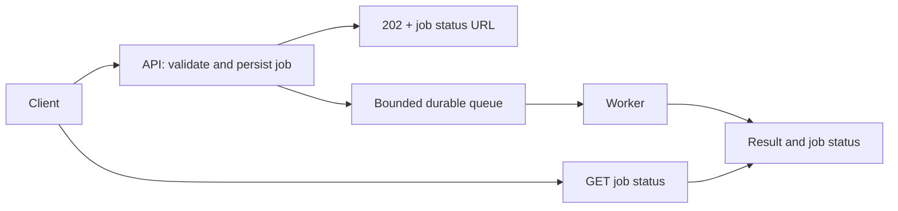

[فارسی](README.md) | **English**

# Chapter 03 — Asynchronous Processing

Users do not need to wait for every task the server performs. Report generation, image conversion, or sending a notification may happen after the request is accepted, provided acceptance, job durability, final result, and failure have a clear contract. This chapter teaches two separate decisions: **which work should leave the response path?** and **how should services transfer that work or event by message?**

**Sources reviewed: 2026-11-10.** The scope comes from the Asynchronism section of the [Backend Performance roadmap](https://roadmap.sh/backend-performance-best-practices). Numerical examples are educational, not measurements of a real system.

## Prerequisites and study order

Know the HTTP request/response cycle and the idea of a database transaction; the first lesson defines arrival rate, response time, and Job status. Both lessons teach their topic from definitions through examples and solved exercises. The table’s order is suggested for building a mental model, not because one lesson is a prerequisite for the other; external links and references are optional.

| Topic | Main problem | Checkable outcome |
| --- | --- | --- |
| [3.1 Background jobs](01-background-jobs/README.en.md) | Move heavy work out of the latency-sensitive path | Job status contract, latency budget, and recovery plan |
| [3.2 Message brokers](02-message-brokers/README.en.md) | Asynchronous communication between producers and consumers | Message contract, delivery guarantees, and flow control |

`async/await` inside a request does not necessarily place work in a durable queue. A Job table plus a Worker can provide background processing without a separate Broker. A Broker also adds communication and operational concerns to the decision.

## Request/response boundary and shared scenario

Suppose generating a sales report takes four seconds. The user first requests it, receives a job ID, and then checks its status. `202 Accepted` means the request was accepted for processing; it does not guarantee successful completion. [MDN’s HTTP 202 guide](https://developer.mozilla.org/en-US/docs/Web/HTTP/Reference/Status/202) explains this distinction.

The initial response becomes faster, but time to the file still includes queue wait and execution. If 30 jobs arrive per second and Workers can actually complete 20 per second, the backlog grows by about 10 jobs each second. A queue buys time; it does not create processing capacity. Track the number waiting, age of the oldest job, completion rate, and end-to-end result time alongside API response time.

In the shared scenario, Lesson 1 determines what must be stored before responding and how the user sees failure. Lesson 2 shows why a disconnect after Publish or after work completes can cause redelivery. Even when the API response is fast, a continuously growing queue age means the product promise is being missed.

## Connections to other chapters

- [Avoiding unnecessary server work](../02-api-response/04-avoid-unnecessary-server-work/README.en.md): before moving work, check whether it is needed at all.
- [Critical paths](../06-code-optimization/04-critical-paths/README.en.md): which step is required to answer this request now?
- [Timeouts and retries](../06-code-optimization/07-timeouts-and-retries/README.en.md): coordinate each-attempt timeout, total job deadline, and retry budget.
- [Horizontal and vertical scaling](../05-load-balancing-and-scaling/01-horizontal-and-vertical-scaling/README.en.md): adding Workers helps only if the database and downstream services have capacity.
- [Metrics, logs, and traces](../07-monitoring-and-logging/01-metrics-logs-and-traces/README.en.md): follow the job ID from request through result.
- [Throttling](../08-security/03-throttling-and-rate-limiting/README.en.md): intake limits help prevent work from accumulating beyond budget.

## Chapter review checklist

- [ ] I can explain initial response, execution start, and successful completion as separate events.
- [ ] Every job type has a deadline, intake capacity, and final status.
- [ ] I monitor backlog and queue age, not only CPU or API response time.
- [ ] I know that storing a Job, publishing, and acknowledging have different failure boundaries.
- [ ] I have a practical response to duplicate messages, concurrent execution, permanent errors, and Worker loss.
- [ ] I can use evidence to decide whether a separate Broker is needed or a simple Job Store is enough.

[Previous chapter: API responses](../02-api-response/README.en.md) · [Course contents](../README.en.md) · [Next chapter: Databases](../04-databases/README.en.md)

