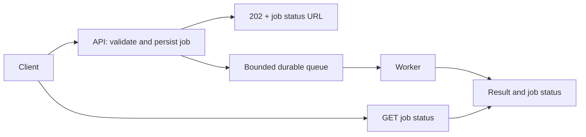

# فصل ۳ — پردازش غیرهمگام | Asynchronism

**زبان:** فارسی · [English version](README.en.md)

کاربر برای هر کاری که سرور انجام می‌دهد لازم نیست منتظر بماند. ساخت گزارش، تبدیل تصویر یا ارسال اعلان را می‌توان بعد از پذیرش درخواست انجام داد؛ به شرطی که پذیرش، ماندگاری کار، نتیجه نهایی و خطا قرارداد روشنی داشته باشند. این فصل دو تصمیم جدا را آموزش می‌دهد: **چه کاری را از مسیر پاسخ خارج کنیم؟** و **سرویس‌ها آن کار یا رویداد را چگونه با پیام منتقل کنند؟**

**تاریخ بررسی منابع: 2026-11-10.** دامنه فصل از بخش Asynchronism در [نقشه‌راه Backend Performance](https://roadmap.sh/backend-performance-best-practices) گرفته شده است. مثال‌های عددی آموزشی‌اند و نتیجه اندازه‌گیری سامانه واقعی نیستند.

## پیش‌نیاز و ترتیب مطالعه

با چرخهٔ درخواست/پاسخ HTTP و مفهوم تراکنش پایگاه داده آشنا باشید؛ در درس اول نرخ ورود، زمان پاسخ و وضعیت Job تعریف می‌شوند. هر دو درس از آغاز تا مثال و پاسخ تمرین در خود صفحه تدریس می‌شوند. ترتیب جدول برای ساختن مدل ذهنی پیشنهاد شده، نه اینکه یکی پیش‌نیاز دیگری باشد؛ پیوندهای بیرونی و منابع اختیاری‌اند.

| موضوع | مسئله اصلی | خروجی قابل بررسی |
| --- | --- | --- |
| [۳.۱ کارهای پس‌زمینه — Background Jobs](01-background-jobs/README.md) | انتقال کار سنگین از مسیر حساس به تأخیر | قرارداد وضعیت، بودجه تأخیر و برنامه بازیابی کار |
| [۳.۲ واسطه‌های پیام — Message Brokers](02-message-brokers/README.md) | ارتباط غیرهمگام تولیدکننده و مصرف‌کننده | قرارداد پیام، ضمانت تحویل و کنترل فشار |

`async/await` در یک درخواست، لزوماً کار را به صف پایدار نمی‌سپارد. همچنین یک جدول Job به همراه Worker می‌تواند کار پس‌زمینه بسازد، بدون آنکه یک Broker مستقل لازم باشد. انتخاب Broker مسئله ارتباط و عملیات سامانه را نیز وارد تصمیم می‌کند.

## مرز درخواست/پاسخ و سناریوی مشترک

فرض کنید ساخت گزارش فروش ۴ ثانیه طول می‌کشد. کاربر ابتدا درخواست می‌دهد، شناسه کار می‌گیرد و سپس وضعیت آن را می‌خواند. پاسخ `202 Accepted` یعنی درخواست برای پردازش پذیرفته شده؛ نتیجه موفق را تضمین نمی‌کند. این تمایز در [راهنمای HTTP 202 در MDN](https://developer.mozilla.org/en-US/docs/Web/HTTP/Reference/Status/202) توضیح داده شده است.

پاسخ اولیه سریع‌تر می‌شود، اما زمان رسیدن به فایل همچنان شامل انتظار صف و اجراست. اگر ورودی ۳۰ کار در ثانیه و ظرفیت واقعی Workerها ۲۰ کار در ثانیه باشد، در هر ثانیه حدود ۱۰ کار به Backlog اضافه می‌شود. صف زمان می‌خرد؛ ظرفیت پردازش ایجاد نمی‌کند. پس تعداد کارهای منتظر، سن قدیمی‌ترین کار، نرخ تکمیل و زمان انتها‌به‌انتهای نتیجه را کنار زمان پاسخ API ثبت کنید.

در این سناریو، درس اول تعیین می‌کند چه چیزی باید پیش از پاسخ ذخیره شود و کاربر چگونه شکست را می‌بیند. درس دوم نشان می‌دهد قطع اتصال بعد از Publish یا بعد از انجام کار چرا ممکن است به تحویل تکراری برسد. حتی اگر پاسخ `API` سریع باشد، رشد مداوم سن صف نشان‌دهنده نقض وعده محصول است.

## ارتباط با فصل‌های دیگر

- [حذف کار غیرضروری سرور](../02-api-response/04-avoid-unnecessary-server-work/README.md): پیش از جابه‌جا کردن کار، بررسی کنید اصلاً لازم است یا نه.
- [مسیرهای بحرانی](../06-code-optimization/04-critical-paths/README.md): کدام مرحله واقعاً برای پاسخ همین درخواست لازم است؟
- [Timeout و Retry](../06-code-optimization/07-timeouts-and-retries/README.md): محدودیت زمانی هر تلاش، مهلت کل کار و بودجه تکرار را هماهنگ کنید.
- [مقیاس‌دهی افقی و عمودی](../05-load-balancing-and-scaling/01-horizontal-and-vertical-scaling/README.md): افزایش Worker فقط وقتی مفید است که پایگاه داده یا سرویس پایین‌دستی ظرفیت داشته باشد.
- [متریک، لاگ و Trace](../07-monitoring-and-logging/01-metrics-logs-and-traces/README.md): شناسه کار را از درخواست تا نتیجه دنبال کنید.
- [کنترل نرخ](../08-security/03-throttling-and-rate-limiting/README.md): محدودیت پذیرش، ابزار جلوگیری از انباشت کار خارج از بودجه است.

## چک‌لیست مرور فصل

- [ ] می‌توانم تفاوت پاسخ اولیه، شروع اجرا و تکمیل موفق کار را توضیح بدهم.
- [ ] برای هر نوع کار، مهلت، ظرفیت پذیرش و وضعیت نهایی مشخص کرده‌ام.
- [ ] Backlog و Queue Age را می‌سنجم و فقط به CPU یا زمان پاسخ API نگاه نمی‌کنم.
- [ ] می‌دانم ذخیره Job، Publish و Ack چه مرزهای خرابی متفاوتی دارند.
- [ ] برای تکرار پیام، اجرای هم‌زمان، خطای دائمی و قطع Worker پاسخ عملی دارم.
- [ ] می‌توانم با شواهد توضیح بدهم Broker مستقل لازم است یا یک Job Store ساده کافی است.

**مسیر مطالعه:** [فصل قبل: پاسخ API](../02-api-response/README.md) · [فهرست بسته](../README.md) · [فصل بعد: پایگاه داده](../04-databases/README.md)

