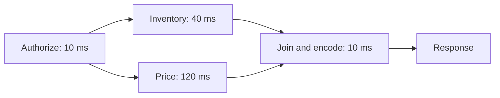

<div dir="rtl" align="right">

# ۶.۴ — شناسایی مسیرهای بحرانی و Endpointهای پرتکرار

**زبان:** فارسی · [English version](README.en.md)


مسیر بحرانی درخواست، زنجیرهٔ وابستگی‌هایی است که پایان پاسخ را تعیین می‌کند. Hot path بخش پرتکرار یا پرمصرف کد است؛ این دو ممکن است هم‌پوشان باشند، ولی یکسان نیستند. CPU بالای یک کار پس‌زمینه لزوماً به معنای حضور آن در مسیر پاسخ نیست، هرچند رقابت منابع می‌تواند غیرمستقیم درخواست را کند کند.

**هدف یادگیری:** رسم وابستگی، محاسبهٔ زمان در شاخه‌های سریال/موازی، اولویت‌بندی هزینه و latency و سنجش سقف سود یک تغییر. پیش‌نیاز: Trace و صدک تأخیر؛ ابتدا [Profiling](../02-application-profiling/README.md). بررسی منابع: **۲۰۲۶-۱۱-۱۰**.

## پیش‌نیازهای همین درس

Trace یک درخواست را به مراحل مرتبط نشان می‌دهد؛ Span یک مرحله یا بازهٔ کار در آن Trace است. p95 زمان را نشان می‌دهد که تقریباً ۹۵٪ مشاهدات در آن یا پیش از آن پایان یافته‌اند. Hot path یعنی کاری که زیاد یا پرهزینه اجرا می‌شود؛ Critical path زنجیره‌ای از وابستگی‌های لازم است که زمان پایان پاسخ را تعیین می‌کند. یک کار می‌تواند یکی باشد و دیگری نباشد.

## مدل ذهنی و روش انتخاب

| پرسش | دادهٔ لازم | تصمیم محتمل |
| --- | --- | --- |
| چرا این درخواست دیر تمام شد؟ | Trace شامل صف و وابستگی‌ها | کوتاه کردن زنجیرهٔ تعیین‌کننده |
| کدام Route بیشترین CPU می‌گیرد؟ | نرخ درخواست × CPU به ازای درخواست | کاهش هزینهٔ پرتکرار |
| چرا فقط p99 بد است؟ | نمونه‌های کند، contention و توزیع ورودی | بررسی Tail و زیرگروه‌ها |
| کدام کار لازم نیست منتظر بماند؟ | قرارداد صحت و تجربهٔ کاربر | حذف یا انتقال تعهد به پس‌زمینه |

[OpenTelemetry Traces](https://opentelemetry.io/docs/concepts/signals/traces/) رابطهٔ Spanها و نمای یک درخواست را توضیح می‌دهد. Span والد زمان فرزند را هم پوشش می‌دهد؛ جمع مدت همهٔ Spanها پاسخ را به دست نمی‌دهد. ساعت ناسازگار میان ماشین‌ها و Sampling ناکافی می‌توانند تفسیر را مختل کنند. صف پیش از Handler را نیز اندازه بگیرید، وگرنه Trace ظاهراً سالم ولی تجربهٔ کلاینت کند می‌ماند.

1. یک هدف روشن مانند p95 برای checkout و یک بار نماینده انتخاب کنید؛ همهٔ Routeها هدف یکسان ندارند.
2. کارهای لازم و وابستگی داده‌ای را رسم کنید؛ فقط کار مستقل را می‌توان موازی کرد.
3. روی Traceهای واقعی سریع و کند، طول زنجیره و انتظار را بخوانید؛ فرض نکنید همواره یک شاخه بحرانی است.
4. سهم قابل‌بهبود را تخمین بزنید و با هزینهٔ تغییر مقایسه کنید.
5. پس از تغییر دوباره مسیر را پیدا کنید؛ گلوگاه ممکن است جابه‌جا شود. هم‌زمانی را به ظرفیت پایین‌دست محدود کنید.

## مثال حل‌شده

در سناریوی **فرضی** زیر، احراز مجوز ۱۰ ms است. سپس موجودی و قیمت مستقل‌اند و هر دو برای پاسخ لازم‌اند. Encode در پایان ۱۰ ms طول می‌کشد. زمان‌ها ثابت، بدون صف و بدون سربار اجرای موازی فرض شده‌اند.

<div dir="ltr" align="left">



```text
serial_time   = 10 + 40 + 120 + 10 = 180 ms
parallel_time = 10 + max(40, 120) + 10 = 140 ms
```

</div>

در حالت موازی، نصف کردن موجودی از ۴۰ به ۲۰ ms زمان ۱۴۰ ms را کم نمی‌کند؛ قیمت همچنان شاخهٔ طولانی‌تر است. نصف کردن قیمت به ۶۰ ms زمان را به ۸۰ ms می‌رساند. اگر قیمت به نتیجهٔ موجودی وابسته باشد، این موازی‌سازی مجاز نیست.

برای تخمین سقف سود در یک مدل ساده، اگر ۲۰٪ زمان قابل‌بهبود باشد و آن بخش دو برابر سریع شود، نسبت سرعت `1/(0.8+0.2/2) ≈ 1.11` است؛ حذف کامل همان بخش حداکثر `1.25` برابر است. این محاسبهٔ سهم ثابت، اثر صف، تغییر بار و tail را مدل نمی‌کند؛ آن‌ها نیازمند سنجش‌اند.

همچنین Route فرضی A با ۱۰۰۰ درخواست/s و ۲ ms CPU، حدود ۲ CPU-second/s مصرف دارد؛ Route B با ۱۰ درخواست/s و ۵۰ ms حدود ۰٫۵ CPU-second/s. A برای ظرفیت مهم‌تر است، اما B ممکن است هدف latency سخت‌تری داشته باشد. نرخ، اهمیت محصول و هزینه را کنار هم ببینید.

## تمرین و انتظار

مثال را با قیمت ۳۰ ms و موجودی ۴۰ ms دوباره حساب کنید. سپس یک صف مشترک ۸۰ ms پیش از هر دو شاخه اضافه کنید. **راه‌حل:** پس از احراز ۱۰ ms، شاخهٔ موجودی ۴۰ ms از قیمت ۳۰ ms طولانی‌تر است؛ زمان پاسخ <span dir="ltr">10 + max(40, 30) + 10 = 60 ms</span> می‌شود. با صف مشترک، <span dir="ltr">80 + 60 = 140 ms</span> است؛ سرعت دادن به یک شاخه اکنون از تأخیر کل محدودتر می‌شود، زیرا صف بخش بزرگی از مسیر است. در یک Trace نمونه، Spanهای هم‌پوشان را رنگ بزنید و به‌جای جمع همه، زنجیرهٔ پایان پاسخ را علامت بزنید. مدت صف را با زمان داخل Handler اشتباه نکنید.

## شاهد واقعی

گزارش **۲۰۲۶** [Discord Voice](https://discord.com/blog/how-we-moved-discord-voice-to-the-edge) نشان می‌دهد حلقهٔ دریافت آماده می‌توانست Flush خروجی را گرسنه نگه دارد. افزودن بودجهٔ زمانی Flush بخشی از مشکل را حل کرد و contention زیرساخت هم جدا اصلاح شد. این شاهد اهمیت زمان‌بندی مسیر خروجی است؛ تعمیم عدد بودجهٔ همان سامانه به HTTP API ما موجه نیست.

## هزینه‌ها و شکست‌ها

| تصمیم/شکست | خطر یا علامت | راه بازبینی |
| --- | --- | --- |
| موازی کردن همهٔ فراخوانی‌ها | Pool اشباع و p99 بدتر | سقف هم‌زمانی، صف محدود، cancellation |
| انتقال کار لازم به background | پاسخ سریع ولی تعهد گم می‌شود | قرارداد پذیرش، ذخیرهٔ پایدار و بازیابی |
| فقط میانگین گرفتن | گروه کوچکی از کاربران بسیار کندند | صدک و برش Route/اندازه/منطقه |
| جمع مدت همهٔ Spanها | زمان برآوردشده بیشتر از پاسخ | هم‌پوشانی و رابطهٔ والد/فرزند |
| حذف بررسی صحت/مجوز | نتیجه سریع ولی نامعتبر | الزام‌های صحت و امنیت را حفظ کن |

### چک‌لیست عملیاتی

- [ ] مرز اندازه‌گیری شامل صف و زمان دید کلاینت روشن است.
- [ ] Trace سریع و کند و ورودی‌های بزرگ بررسی شده‌اند.
- [ ] Hot path هزینه و Critical path تأخیر جدا اولویت‌بندی شده‌اند.
- [ ] وابستگی داده‌ای پیش از موازی‌سازی تأیید شده است.
- [ ] سهم سود احتمالی، خطا و هزینهٔ منابع محاسبه شده‌اند.
- [ ] پس از تغییر، جابه‌جایی گلوگاه و p99 دوباره بررسی می‌شود.

## آزمون

1. آیا پرمصرف‌ترین تابع CPU همیشه مسیر بحرانی latency است؟
2. چرا زمان دو شاخهٔ موازیِ لازم معمولاً با بیشینهٔ آن‌ها مدل می‌شود؟
3. در مثال ۱۴۰ ms، نصف کردن موجودی چقدر تأخیر را کم می‌کند؟
4. اگر قیمت به موجودی وابسته باشد چه تغییری در مدل لازم است؟
5. حذف کامل بخشی که ۲۰٪ زمان است، در مدل سهم ثابت چه سقف سودی دارد؟
6. چرا افزایش هم‌زمانی می‌تواند پاسخ را کندتر کند؟

### پاسخ تشریحی

1. خیر؛ کار می‌تواند پرتکرار یا پس‌زمینه باشد، و مسیر پاسخ ممکن است بیشتر منتظر I/O بماند.
2. Join باید منتظر کندترین شاخه بماند؛ با فرض شروع هم‌زمان و نبود contention، زمان آن شاخه پایان را تعیین می‌کند.
3. در مدل ثابت صفر؛ قیمت ۱۲۰ ms همچنان طولانی‌ترین شاخه است.
4. دو مرحله سریال می‌شوند؛ نمی‌توان پیش از آماده بودن ورودی قیمت آن را آغاز کرد.
5. `1/0.8=1.25` برابر؛ بخش ۸۰٪ باقی می‌ماند. این سقف مدل ساده است.
6. رقابت CPU، قفل، اتصال و پایین‌دست می‌تواند صف و خطا بسازد؛ موازی بودن منابع بی‌نهایت ایجاد نمی‌کند.

## جمع‌بندی

برای latency، از Trace زنجیرهٔ پایان پاسخ و انتظارهای آن را بیابید؛ برای ظرفیت، Routeهای پرتکرار و CPU به‌ازای کار موفق را بررسی کنید. فقط کارهای واقعاً مستقل را موازی کنید و گلوگاه جابه‌جاشده را پس از تغییر دوباره پیدا کنید.

## منابع تکمیلی اختیاری

برای فهم این درس یا حل تمرین، بازکردن پیوندهای زیر لازم نیست؛ آن‌ها برای مطالعهٔ بیشتر و بررسی رفتار مستند ابزارها هستند.

- **فارسی:** در جست‌وجوی این بررسی، منبع فارسی مستقیمی با تمرکز دقیق بر Critical path در Trace درخواست و محاسبهٔ هم‌پوشانی پیدا نشد؛ توضیح و تمرین فارسی همین درس برای این شکاف نوشته شده‌اند. منابع مدیریت پروژه با همین نام جایگزین مناسبی نیستند.
- [فارسی مکمل: ردیابی توزیع‌شده](https://pro-nee.net/terms/distributed-tracing/): آشنایی با Trace/Span و دنبال کردن مسیر درخواست؛ مرجع محاسبات این درس نیست.
- [English: OpenTelemetry Traces](https://opentelemetry.io/docs/concepts/signals/traces/): مفاهیم و رابطهٔ Spanهای درخواست.
- [English: Google Cloud traces and spans](https://docs.cloud.google.com/trace/docs/traces-and-spans): مدل Trace ID، Span و زمان درخواست در سامانهٔ Cloud Trace؛ مثال ابزار گوگل است و الزام پیاده‌سازی نیست.
- [English: Azure optimize code](https://learn.microsoft.com/en-us/azure/well-architected/performance-efficiency/optimize-code-infrastructure): شناسایی hot path و انتخاب تغییر بر اساس داده.
- [English: Discord Voice](https://discord.com/blog/how-we-moved-discord-voice-to-the-edge): نمونهٔ عملی زمان‌بندی و starvation.

**ناوبری:** [فصل ۶](../README.md) · [فهرست اصلی](../../README.md) · [قبلی: الگوریتم‌ها](../03-algorithms-and-data-structures/README.md) · [بعدی: زبان و Runtime](../05-language-and-runtime-choices/README.md)

**مرتبط:** [کارهای پس‌زمینه](../../03-asynchronism/01-background-jobs/README.md) · [Timeout/Retry](../07-timeouts-and-retries/README.md) · [Performance Testing](../../09-performance-testing/README.md)

</div>
