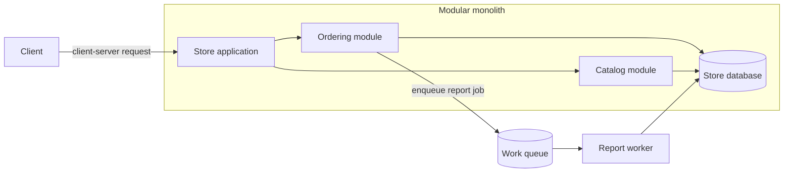

# Architectural Styles

> **Language:** [Persian edition](../../../../../07/architectural-styles/topics/architectural-styles/README.md)

> [Read the full chapter lesson](../../lessons.md) for a detailed comparison, case studies, and a worked decision exercise.

**Roadmap location:** [Architectural Styles](../../README.md) · [Full course index](../../../../00-index.md)

## Learning goals

After this topic, you should be able to explain what an architectural style constrains, distinguish broad structure from a technology choice, and follow a reasoned path to a style that fits a product and team.

## Core idea

An architectural style defines constraints on the kinds of components a system contains and how they may communicate. Those constraints make some properties easier to achieve and others more expensive. “Modern” and “scalable” are not enough to guide a decision; name the workload, quality goals, team constraints, and costs you are willing to accept.

An architectural style is not a programming language or cloud product. A system can use a modular monolith internally, a client-server API at its edge, and a queue for background work. It may combine styles when each boundary solves a distinct problem.

## Explore the styles

| Topic | What it explains | Start here when… |
| --- | --- | --- |
| [Component-based](../component-based/README.md) | Grouping related capabilities behind controlled interfaces. | You need modularity inside one process. |
| [Monolithic](../monolithic/README.md) | One deployable application unit, with or without internal modules. | You are evaluating the cost of one coordinated deployment. |
| [Layered](../layered/README.md) | Logical responsibility layers and dependency direction. | You need to separate presentation, rules, and infrastructure. |
| [Structural styles](../structural-style/README.md) | How components and connectors form a data or control flow. | You are comparing pipelines and connected subsystems. |
| [Client-server](../client-server/README.md) | Requests from clients to a server that owns capabilities or resources. | You need a network API and must reason about timeouts and trust. |
| [Peer-to-peer](../peer-to-peer/README.md) | Nodes that can provide and consume resources. | Direct exchange or decentralized membership is a product need. |
| [Distributed systems](../distributed/README.md) | Failure and consistency costs across networked processes. | Multiple processes must coordinate over a network. |
| [Event-driven](../event-driven/README.md) | Producers publish facts and consumers react asynchronously. | Several independent consumers need to react to changes. |
| [Publish-subscribe](../publish-subscribe/README.md) | One publisher delivers messages to interested subscribers. | You need fan-out without a producer maintaining a subscriber list. |
| [Messaging](../messaging/README.md) | Queues, streams, delivery, and message contracts. | You need to buffer work or retain a consumable event history. |

## A practical example

An online store has one team and a small set of business rules. Start with one application unit and clear modules for ordering, catalog, and payment. If a nightly report runs for several minutes, move that work behind a queue and process it with a worker. This can keep the interactive request responsive without turning every module into a network service.

Revisit the boundaries when measurements show a real need for independent deployment, scaling, security isolation, or team ownership. Service extraction adds network latency, partial failure, data-consistency work, observability, and on-call responsibility. Include those costs in the decision.

The diagram combines a client-server edge, in-process modules, and asynchronous background work. It is one possible starting point, not a universal template.

## Decision checklist

Before selecting a style, write down:

1. The business capabilities and the parts that change together.
2. Required latency, availability, security, and recovery behavior.
3. Whether work is interactive, batch, streaming, or compute-heavy.
4. Data ownership and which operations need one transaction.
5. The team's ability to deploy, observe, secure, and support the design.
6. A simpler structure that could satisfy the same requirement.
7. Evidence that would make the team revisit the decision.

## Common mistakes

- Treating “microservices,” “serverless,” or “cloud-native” as a goal without identifying a product need.
- Choosing a style because a company used it for a different workload.
- Confusing logical layers with deployment tiers.
- Adding asynchronous events without delivery, retry, ordering, privacy, and observability decisions.
- Splitting a monolith before the team understands the module boundaries and data ownership.
- Assuming a distributed design is automatically more available or scalable.

## Answered quiz

1. **What does an architectural style constrain?**
   **Answer:** Which component types and relationships are allowed, and therefore how the system is structured and communicates.

2. **Is Kubernetes an architectural style?**
   **Answer:** No. It is a platform for running workloads; it can host applications designed with different styles.

3. **Can one system combine styles?**
   **Answer:** Yes. A modular monolith can expose a client-server API and use a queue for long-running work, provided each boundary has a clear purpose.

4. **What should justify extracting a module into a service?**
   **Answer:** A measurable need for independent deployment, scaling, security isolation, or ownership that is worth the new network and operating costs.

5. **Why should a published company result not be copied blindly?**
   **Answer:** Workloads, teams, costs, and goals differ. A case study supports questions and measurement; it is not a universal rule.

## Further reading

### English

- [Microsoft Azure Architecture Center — Architecture styles](https://learn.microsoft.com/en-us/azure/architecture/guide/architecture-styles/) — Constraints, common workloads, benefits, and challenges.
- [Martin Fowler — Microservices](https://martinfowler.com/articles/microservices.html) — Service autonomy and the costs of distributed boundaries.
- [AWS Well-Architected — Choose how to segment your workload](https://docs.aws.amazon.com/wellarchitected/latest/framework/rel_service_architecture_monolith_soa_microservice.html) — Workload segmentation, reliability, and operating costs.
- [Google SRE — Addressing Cascading Failures](https://sre.google/sre-book/addressing-cascading-failures/) — Overload, retries, and distributed failure propagation.

### Persian

- [DNTips — Layered Architecture, Part 2](https://www.dntips.ir/post/1261) — A Persian introduction to layer responsibilities.
- [EventDrivenFarsi](https://github.com/gloonch/eventdrivenfarsi) — Persian articles on event-driven systems, Kafka, event sourcing, and CQRS.

For more sources grouped by chapter, see the [course reference library](../../../../references.md#chapter-07).

