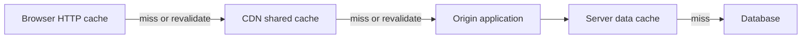

<div dir="ltr" align="left">

[فارسی](../../../../fa/backend-performance/01-caching/01-cache-layers/README.md) | **English**

# 01.1 — Cache Layers: HTTP, Client, Server, and CDN

**Sources reviewed: 2026-11-10** · Prerequisites: an HTTP request path and the idea of a database · Suggested time: one study and practice session.

## Basic terms in this lesson

An HTTP request is a message sent by a client to a server; an HTTP response returns a status, headers, and, when needed, a result body. A database is the persistent store of primary data. In any cache, a **hit** means a usable copy was found and a **miss** means the next stage must be consulted; “usable” also depends on freshness and authorization. These definitions are enough to follow the paths below; no other page is required.

## Learning objective and definition

After this lesson, you can identify where a result is stored in the request path, explain the difference between response caching and data caching, and choose different policies for public and personal responses. A **cache layer** is a place where a result is stored and reused. **HTTP caching** is a contract for reusing HTTP responses and can be implemented in several places. Therefore, HTTP, a browser, and a CDN are not three independent, equivalent technologies: browsers and CDNs can implement the same HTTP contract.

## Mental model: what work does each hit remove?

| Layer | What it stores | Path removed on a hit | Important limit |
| --- | --- | --- | --- |
| Browser; private HTTP cache | A response suitable for that user | Network request for a response that is still fresh | The server cannot purge every browser under its control |
| Client-application cache | Data or a result in application memory, such as the last search | API call | Its rules need not be HTTP rules; logout must be handled |
| CDN or reverse proxy; shared cache | A response shared across eligible requests | Journey to the origin | The key and sharing policy must prevent data leaks |
| Server response cache | A constructed endpoint response | Depending on placement, part of routing, query, and serialization | Identity, language, and query dimensions must be separated correctly |
| Server data cache; local or shared | An entity, query result, or computation | An expensive access or computation | The server still handles the request and response |

Private/shared distinctions and header roles are defined in [RFC 9111, Sections 1 and 4](https://www.rfc-editor.org/rfc/rfc9111.html#section-1). Ordinary data caching is outside this RFC’s scope; adding `Cache-Control` to a response does not expire your internal Redis entries.

<div dir="ltr" align="left">



</div>

First determine when two requests are “the same”: can the URL, query, language, encoding, or identity change the result? Next choose which data is safe to share. Then set freshness and validation rules. `Vary` tells an HTTP cache which request header to compare when selecting a stored representation; it does not replace access control. In the example, language requires `Vary: Accept-Language`; for compressed content, `Accept-Encoding` may also need to be included, depending on the response producer. [Technical basis: RFC 9111, Section 4.1](https://www.rfc-editor.org/rfc/rfc9111.html#section-4.1).

| Response directive | Practical meaning |
| --- | --- |
| `max-age=60` | Compute freshness using the response’s age and the declared duration, not the time the cache installed it |
| `s-maxage=300` | Freshness duration for a shared cache; it takes precedence over `max-age` there |
| `private` | Do not store the response in a shared cache; this does not privatize a cache key |
| `no-cache` | Reuse requires successful validation; it does not forbid storage |
| `no-store` | A cache must not store this exchange; it is not a purge command for old copies |

The exact directives are defined in [RFC 9111, Section 5.2.2](https://www.rfc-editor.org/rfc/rfc9111.html#section-5.2.2). The mere presence of `Set-Cookie` is not a general cache-prevention strategy; inspect explicit policy and product configuration.

## When is this useful, and what does it cost?

Versioned public files, product descriptions, and repeated search responses are reasonable candidates. First check whether the main cost is network distance or a query/computation: a data-cache hit may skip the query while leaving the network path intact. A personal response may use a suitable private policy, while highly sensitive information may need `no-store`. This depends on product requirements; “cache every GET” is not a sound policy.

Many key dimensions fragment versions and reduce hits. Removing a dimension that changes the result to increase hit ratio returns incorrect data. A nearer cache usually removes more of the path, but invalidating every copy is harder. Choosing a CDN PoP and network cost continues in the [CDN lesson](../../10-network/03-cdn-for-static-and-frequent-content/README.en.md).

## Worked example: a bilingual public response

**Illustrative scenario; not run or measured.** `/catalog/42`, with no user identity, returns a public description in the requested language. For simplicity, the initial response age is zero, and we assume no errors or CDN-specific overrides.

<div dir="ltr" align="left">

```http
GET /catalog/42 HTTP/1.1
Host: example.test
Accept-Language: fa

HTTP/1.1 200 OK
Content-Type: application/json
Cache-Control: public, max-age=30, s-maxage=120
Vary: Accept-Language
ETag: "catalog-42-fa-v7"

{"id":42,"title":"Example product"}
```

</div>

At second 20, the browser can reuse the still-fresh response. At second 40, the browser copy is no longer fresh, so it sends a request; the CDN may serve its still-fresh Persian response under `s-maxage=120`, without going to the origin. At age 130, the CDN copy is stale too and needs validation or a new response. If the validator still matches, a conditional response can be `304 Not Modified` and avoid sending the body again; 304 still takes a round trip and may require server work. [MDN’s HTTP caching guide](https://developer.mozilla.org/en-US/docs/Web/HTTP/Guides/Caching#validation) illustrates this conditional flow.

Do not copy this public policy to `/me`. In this scenario, the product decision is not to store account information, so that response uses `Cache-Control: no-store`. Separating users’ results in an internal cache is also the application’s responsibility.

## Exercise and worked solution

1. On paper, mark the path for a `fa` request at ages 20, 40, and 130 seconds; then add an `en` request at second 20.
2. If you have an endpoint in a test environment you control, set these headers and reopen a fixed URL in the browser Network panel with Disable cache off. Record transferred bytes, status, and `Age` if present.
3. Replace the public policy with only `no-cache`; with a stable validator, expect a conditional request, not necessarily a body download.

**Expected:** An English request must not receive Persian just because the Persian variant hit. A repeat request may be served from memory/disk or the edge, or receive 304; do not call all of these the same kind of hit. Browser reload, CDN settings, and actual headers alter behavior. Ordinary `curl` does not use the browser cache; two `curl` runs alone do not demonstrate a private browser-cache hit.

### Step-by-step solution

At age 20, the Persian browser copy is within `max-age=30`, so no network request is needed. The English request selects a separate `Accept-Language: en` variant; if that variant is not already stored, it proceeds to the CDN/origin and cannot use the Persian copy. At age 40, the Persian browser copy is stale and sends a request; the CDN may still serve its fresh copy under `s-maxage=120`. At age 130, the shared-cache freshness has also expired, so the CDN must validate or fetch a new response. Replacing the policy with `no-cache` still permits storage, but requires validation before reuse; after a 304, the body need not be downloaded again.

## Public evidence and limits

> **Product operational documentation, not a customer benchmark:** [Cloudflare’s official ETag guide](https://developers.cloudflare.com/cache/reference/etag-headers/) shows how a real CDN manages origin and browser validators and distinguishes strong and weak ETags. This is evidence of the HTTP contract being used across multiple layers. It does not establish a latency reduction for our hypothetical service or identical behavior across CDNs.

## Common failures and operational signals

| Failure | Signal | Practical inspection |
| --- | --- | --- |
| A personal response is shared | Another user sees the first user’s name/cart | Check private/no-store policy, bypass, and keys using two identities |
| Key omits language or an effective query | A response changes with an unrelated parameter | Compare a URL/query/language matrix with response bodies |
| `no-cache` is confused with `no-store` | A response remains stored despite an expectation of no storage | Inspect actual response headers after every proxy |
| Data-cache hit but TTFB stays high | Database load falls while path latency remains | Separate trace to origin from serialization and network cost |
| Purge reaches only the CDN | Some users still see an old version | Inspect browser lifetime and versioned URLs |

## Operational checklist

- [ ] Each endpoint is classified as public, private, or not storable.
- [ ] Keys and `Vary` cover every result-changing dimension; access control remains independent.
- [ ] Headers reaching the user have been compared with those produced by the origin.
- [ ] Hit/miss/bypass/revalidation are recorded separately at each layer.
- [ ] TTFB and transferred bytes, as well as origin request and query rates, are measured.
- [ ] A 304 is not treated as proof that the server did no work.
- [ ] Content changes and user logout are checked against stored copies.

## Self-check

1. Is an “HTTP cache” necessarily a separate server alongside Redis?

2. What is the difference between `no-cache` and `no-store`?

3. Why does adding Redis not necessarily remove latency for a user far from the origin?

4. In the example with a response age of 40 seconds, which duration applies to a shared cache?

5. If the language header changes the result, how does HTTP caching keep the variants separate?

6. Does a 304 prove that the request did not reach the origin?

### Answers with reasoning

1. No. It is a contract for storing and reusing HTTP responses, implemented by a browser, proxy, or CDN. Redis can be separate and used for internal data.

2. `no-cache` requires validation before reuse; `no-store` prohibits storing this exchange. Neither directive alone purges every previously stored copy.

3. A data-cache hit can remove a database query, but the request still travels over the network to the application and the response still has to be processed.

4. `s-maxage=120` applies to a shared cache; `max-age=30` applies to a browser. Include the response age in the freshness calculation.

5. In the example, `Vary: Accept-Language` separates the variants. Without separating dimensions that affect the result, a cache may select the wrong variant. This does not replace authorization.

6. No. Revalidation may reach the origin. A 304 avoids sending the body again and does not necessarily reduce the number of all round trips.

## Summary

The HTTP contract can be implemented by a browser, CDN, or proxy; server data caching is a separate contract. Choose a layer based on the work it removes, key dimensions, and data sensitivity, and evaluate every hit against age, identity, and the remaining request path.

## Optional references and further reading

The concepts, example, and exercise answer are complete on this page. These links are optional for further study and technical verification.

- English, primary standard: [RFC 9111 — HTTP Caching](https://www.rfc-editor.org/rfc/rfc9111.html), for private/shared caches, response age, and Cache-Control directives.
- English, primary standard: [RFC 9110 — HTTP Semantics](https://www.rfc-editor.org/rfc/rfc9110.html), for validators and conditional requests.
- English, educational: [MDN HTTP caching](https://developer.mozilla.org/en-US/docs/Web/HTTP/Guides/Caching), for browser behavior, conditional validation, and reloads.
- English, product documentation: [Cloudflare ETag headers](https://developers.cloudflare.com/cache/reference/etag-headers/), for limitations of a real CDN implementation.
- English, official architecture guidance: [Azure caching best practices](https://learn.microsoft.com/en-us/azure/architecture/best-practices/caching), for choosing cache data and placement; this is architecture guidance, not an HTTP standard or universal product rule.
- Persian, supplementary reading: [NSIN guide to CDN caching](https://nsin.ir/blog/how-cdn-caching-works/), for cache-key, TTL, and purge vocabulary. Do not treat product-specific numbers or rules as HTTP law; use the RFC and your own product documentation when they differ.

[Chapter contents](../README.en.md) · [Course contents](../../README.en.md) · [Next: Cache patterns](../02-cache-patterns/README.en.md) · [Related: Smaller API responses](../../02-api-response/01-payload-size/README.en.md)

</div>
