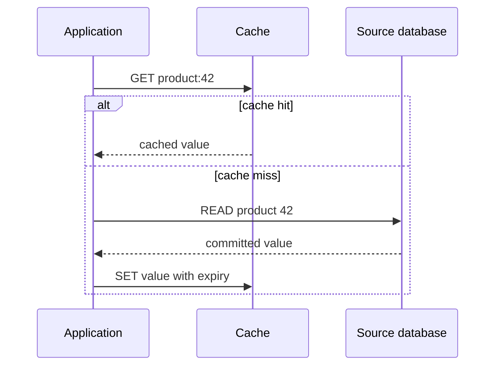

<div dir="ltr" align="left">

[فارسی](../../../../fa/backend-performance/01-caching/02-cache-patterns/README.md) | **English**

# 01.2 — Cache-aside, Read-through, and Write-through Patterns

**Sources reviewed: 2026-11-10** · Prerequisites: key/value, the primary data source, and commit · Suggested previous topic: [Cache layers](../01-cache-layers/README.md).

## Terms used in this lesson

A **key** identifies a value in the cache; a **hit/miss** means a usable copy was/was not found. The **source of truth** is where the authoritative value comes from. A database **commit** means its durable change has been accepted. These terms are defined here; reading the suggested previous lesson is optional.

## Learning objective and definitions

After this lesson, you can identify who handles a cache miss, design read and write paths separately, and explain why “both values were written” does not mean there is an atomic transaction across a database and cache. A caching pattern is a contract among the **application, cache, and primary source**; the tool name alone does not define that contract.

In this lesson, **Cache-aside** means that application code coordinates the cache lookup, source load, and cache population. **Read-through** means the application calls an abstraction with a loader, and that layer supplies data from the source on a miss. **Write-through** means writes go through a defined intermediary that applies them to the durable source and cache before success is reported, according to the contract. Implementations name these patterns differently; read the chosen product’s error and ordering contract. [Azure Architecture Center introduces this family of patterns](https://learn.microsoft.com/en-us/azure/architecture/patterns/cache-aside).

## Mental model and comparison

| Pattern | Who handles a read miss? | Write path in this lesson | Main cost or risk |
| --- | --- | --- | --- |
| Cache-aside | Application code | Commit to source, then invalidate dependent entry | Repeated code, slower miss, inconsistency window |
| Read-through | Loader in cache layer/library | Defined independently; may be combined with write-through | Loader-contract dependency, error management, invalidation outside it |
| Write-through | Does not define the read pattern | Write intermediary coordinates source and cache before confirmation | More work on the write path and partial-failure handling |

Read-through and write-through are separate axes: the first describes reads, the second describes writes. A simple wrapper can provide read-through; ordinary Redis does not automatically know about your SQL database. Write-through also differs from write-behind: in write-behind, updating the source is deferred, making durability and replay central concerns; implementation is outside this lesson. [AWS ElastiCache’s lazy-loading and write-through strategies](https://docs.aws.amazon.com/AmazonElastiCache/latest/dg/Strategies.html) illustrate miss cost and writing data that may never be read.

<div dir="ltr" align="left">



</div>

This diagram is Cache-aside. In Read-through, lookup and loader move inside the abstraction; moving that responsibility does not remove source I/O on a miss.

## When should you choose each pattern?

Cache-aside is a simple starting point for frequently reused results when all source data need not fit in memory. If each request has a new key, cache lookup and fill add cost to a miss with little reuse benefit. Read-through can make loader and error handling consistent across consumers; the loader should not secretly run unbounded queries or infinite retries.

Consider write-through when every writer can go through the intermediary and the extra write work is acceptable. A SQL job, migration, or another service that changes the source directly breaks this assumption. Even with write-through, eviction and restart can empty the cache; reads still need a miss path. For access rights, authoritative inventory, or financial calculations, validate correctness against the transaction/authoritative source; a cache hit alone is not a business guarantee.

## Worked example: public product description with Cache-aside

**Illustrative assumptions:** A product description may be stale for a limited time; the database is the primary source. All example values are configuration choices, not recommendations. The key includes tenant and schema version; add other dimensions such as language if they affect the data.

<div dir="ltr" align="left">

```text
function readProduct(tenantId, productId):
    authorizeRead(tenantId, productId)
    key = "product:v2:" + tenantId + ":" + productId
    cached = cache.tryGet(key, cacheTimeBudget)
    if cached.found:
        return cached.value

    # A cache error is distinct from an ordinary miss in metrics.
    value = source.readCommitted(tenantId, productId, sourceTimeBudget)
    cache.trySet(key, value, ttlSeconds=60)  # bounded best effort
    return value

function updateProduct(tenantId, productId, change):
    authorizeWrite(tenantId, productId)
    source.commitChange(tenantId, productId, change)
    cache.tryDelete("product:v2:" + tenantId + ":" + productId)
```

</div>

On the first read, an empty cache causes the source to be read and the result to be stored for 60 seconds. A second read before expiry may hit. After the writer commits, deleting the entry allows the next read to see the source. **This pseudocode is intentionally a basic lesson with limited guarantees:** record a failed delete and recover from it; for dependable invalidation, an outbox may record the invalidation event with the commit and a retryable worker can process it. See the [background jobs lesson](../../03-asynchronism/01-background-jobs/README.en.md).

Commit-then-delete reduces the chance of caching uncommitted data in the gap between invalidation and commit, but it does not solve every race. Example: reader A reads version 7 from the source; writer B commits version 8 and deletes the key; then A inserts version 7 into the cache. Stale data may be served until another invalidation or expiry. Stronger guarantees require version/generation checks, control over cache fills, and read-path review; see [invalidation and freshness](../04-invalidation-and-freshness/README.en.md).

A cache error is not the same as a miss: if every request falls through to the source during a cache outage, source capacity may be exceeded. Add a source concurrency limit, deadline, and degradation behavior; choose the policy based on data sensitivity.

## Exercise and worked solution

Make a small table with `source version`, `cache version`, and “who answers”:

1. The source is at version 7 and the cache is empty; perform two reads.
2. Commit version 8 to the source but assume deletion fails.
3. Read once before expiry and once after expiry.
4. Move these reads to a hypothetical `getOrLoad(key, loader)` abstraction and note which caller responsibility went away.
5. Assume a write-through source commit succeeds but cache write fails. Define the API response contract and retry.

**Expected:** In step 1, one source read suffices; in step 2, stale data appears; in step 3, expiry gives another chance to load. Moving to Read-through does not automatically fix write inconsistency. In step 5, you cannot say “nothing happened”: the source changed. A retry without idempotency may repeat a business effect. This is path accounting, not a Redis speed benchmark.

### Step-by-step solution

The first read misses, loads version 7, and fills the cache; the second read hits version 7. After version 8 commits, a failed delete means a read before expiry may still return version 7. After expiry, the read loads from the source again and sees version 8, assuming the source itself is fresh. `getOrLoad` moves lookup and loader responsibility into the abstraction; it does not solve the write inconsistency window. If Write-through commits the source and the cache write fails, the source has changed. Surface the failure and make it recoverable; a retry must use a stable key for the same operation and an idempotency rule so the effect is not repeated.

## Public engineering evidence

> [Meta Engineering’s report from April 15, 2013](https://engineering.fb.com/2013/04/15/core-infra/scaling-memcache-at-facebook/) says Facebook began using memcached in 2005 in response to query growth and longer page loads. The report also discusses skewed popularity and fan-out. This is evidence of caching beside a source in practice; it does not establish the exact Write-through contract or an atomic guarantee. The linked USENIX technical paper was unavailable during review (403); this lesson does not repeat its detailed claims.

Our teaching takeaway is to choose the pattern based on read reuse and source cost, not only the database name or organization size.

## Failures, signals, and checklist

| Failure | Observable signal | Inspection action |
| --- | --- | --- |
| Every miss runs multiple queries | Query count per request and miss p95/p99 rise | Trace the loader separately |
| Failed deletion after commit | Source/cache versions differ; invalidation errors | Record event, bounded retry, and fallback TTL |
| Key omits tenant or schema version | Mixed responses or deserialize failures | Review namespace and two-tenant scenario |
| Writer bypasses intermediary | Source changes without cache changes | Enumerate every writer and propagation path |
| Missing value confused with temporary failure | “Not found” stored after a source timeout | Negative-cache only a confirmed absence with an explicit TTL |

- [ ] Source of truth and lookup/load/write owner are documented for each pattern.
- [ ] Miss, cache error, loader error, and write error have separate counters.
- [ ] Cache and source wait times are bounded; fallback capacity is assessed.
- [ ] Cache fills have TTL and size limits; absence of TTL is an explicit decision.
- [ ] All writers and dependent keys, including lists and searches, are known.
- [ ] Partial write failure and repeated API requests are idempotent.
- [ ] Failed invalidation and concurrent-reader cases are exercised.

## Quiz

1. What is the defining difference between Cache-aside and Read-through?
2. Does choosing Read-through specify how writes happen?
3. Why does Write-through not necessarily mean an atomic SQL/cache transaction?
4. Which data gets little benefit from Cache-aside: frequently reused keys or a unique result for every request? Why?
5. Does commit-then-delete eliminate every race? Give a violating ordering.
6. Why is “send all requests directly to the source” insufficient during a cache failure?

### Explained answers

1. The owner of miss logic: the caller in Cache-aside, the abstraction/loader in Read-through. Measure the real number of I/Os too.
2. No. Reads and writes are separate contracts and can be combined in different ways. Define write behavior and invalidation separately.
3. The source and cache may be independent systems with partial failures; one may succeed while the other fails without extra coordination.
4. A unique result for every request: reuse is low, while lookup and fill add overhead.
5. No. A reads version 7, B commits version 8 and deletes the key, then A fills version 7. Version control and concurrency design are needed.
6. A sudden wave of misses may exceed source capacity; define concurrency limits, deadlines, and error/degradation behavior.

## Summary

The read pattern determines who handles a miss; the write pattern separately defines how changes are coordinated. Cache-aside is simple and explicit, but must handle commit, failed invalidation, concurrent loaders, and partial failure. No pattern replaces the source of truth or its consistency contract.

## Optional references and further reading

All pattern definitions and analysis are on this page. These sources are optional further reading and references for specific tool contracts.

- English, official architecture: [Microsoft Cache-aside pattern](https://learn.microsoft.com/en-us/azure/architecture/patterns/cache-aside), for application responsibility, freshness, and consistency limits.
- English, product guide: [AWS ElastiCache caching strategies](https://docs.aws.amazon.com/AmazonElastiCache/latest/dg/Strategies.html), for lazy loading, write-through, and their costs; separate product details from the general pattern.
- English, first-party product guide: [Redis Cache-aside use case](https://redis.io/docs/latest/develop/use-cases/cache-aside/), for one implementation of cache-aside; its Redis specifics do not define every cache.
- English, engineering case: [Scaling memcache at Facebook](https://engineering.fb.com/2013/04/15/core-infra/scaling-memcache-at-facebook/), for usage context and workload shape.
- English, official architecture: [AWS Transactional Outbox](https://docs.aws.amazon.com/prescriptive-guidance/latest/cloud-design-patterns/transactional-outbox.html), for coordinating an event with a source commit.
- Persian, supplementary guide: [DevNA: Cache-aside, TTL, and eviction](https://devna.ir/articles/redis-caching-guide), for vocabulary and code examples; its experimental numbers are not capacity targets for your system.

[Chapter contents](../README.en.md) · [Course contents](../../README.en.md) · [Previous: Cache layers](../01-cache-layers/README.en.md) · [Next: Multi-level caching](../03-multi-level-caching/README.en.md) · [Related: Timeouts and retries](../../06-code-optimization/07-timeouts-and-retries/README.en.md)

</div>
