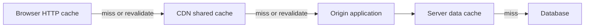

<div dir="rtl" align="right">

# ۰۱.۱ — لایه‌های کش: HTTP، کلاینت، سرور و CDN

**زبان:** فارسی · [English version](../../../../en/backend-performance/01-caching/01-cache-layers/README.md)


**تاریخ بررسی منابع: ۲۰۲۶-۱۱-۱۰** · پیش‌نیاز: مسیر یک درخواست HTTP و مفهوم پایگاه داده · زمان پیشنهادی: یک نشست مطالعه و تمرین.

## اصطلاح‌های پایه در همین درس

درخواست HTTP پیامی است که کلاینت به سرور می‌فرستد؛ پاسخ HTTP وضعیت، Header و در صورت نیاز بدنهٔ نتیجه را برمی‌گرداند. پایگاه داده محل پایدار دادهٔ اصلی است. در هر کش، **hit** یعنی نسخهٔ قابل‌استفاده پیدا شده و **miss** یعنی باید مرحلهٔ بعد را پرسید؛ «قابل‌استفاده» به تازگی و مجوز نیز وابسته است. این تعریف‌ها برای دنبال‌کردن مسیرهای زیر کافی‌اند؛ مطالعهٔ صفحهٔ دیگری پیش‌نیاز نیست.

## هدف یادگیری و تعریف

پس از این درس می‌توانید محل نگهداری نتیجه را در مسیر درخواست مشخص کنید، تفاوت کش پاسخ و کش داده را توضیح دهید و برای پاسخ عمومی و شخصی سیاست متفاوت بنویسید. **لایه کش** محل نگهداری و استفاده دوباره از نتیجه است؛ **HTTP caching** قرارداد استفاده دوباره از پاسخ HTTP است و می‌تواند در چند محل اجرا شود. بنابراین HTTP، مرورگر و CDN سه فناوری مستقل و هم‌عرض نیستند: مرورگر و CDN می‌توانند مجری همان قرارداد باشند.

## مدل ذهنی: هر hit چه کاری را حذف می‌کند؟

| لایه | چه چیزی نگه می‌دارد؟ | در hit چه مسیری حذف می‌شود؟ | محدودیت مهم |
| --- | --- | --- | --- |
| مرورگر؛ private HTTP cache | پاسخ مناسب همان کاربر | درخواست شبکه برای پاسخ هنوز تازه | کنترل پاک‌سازی همه مرورگرها در اختیار سرور نیست |
| کش برنامه کلاینت | داده یا نتیجه در حافظه برنامه، مثلاً فهرست آخرین جست‌وجو | فراخوانی API | قواعد آن الزاماً قواعد HTTP نیست؛ خروج کاربر باید مدیریت شود |
| CDN یا reverse proxy؛ shared cache | پاسخ مشترک بین درخواست‌های مجاز | مراجعه تا origin | کلید و سیاست اشتراک باید جلوی نشت داده را بگیرد |
| کش پاسخ در سرور | پاسخ ساخته‌شده endpoint | بخشی از routing، query و serialization بسته به محل آن | ابعاد هویت، زبان و query باید درست جدا شوند |
| کش داده در سرور؛ محلی یا مشترک | موجودیت، query result یا محاسبه | دسترسی یا محاسبه پرهزینه | سرور همچنان باید درخواست و پاسخ را پردازش کند |

تقسیم private و shared و نقش هدرها در [RFC 9111، بخش‌های ۱ و ۴](https://www.rfc-editor.org/rfc/rfc9111.html#section-1) تعریف شده است. کش داده معمولی زیر کنترل این RFC نیست؛ گذاشتن `Cache-Control` در پاسخ، Redis داخلی شما را منقضی نمی‌کند.

<div dir="ltr" align="left">



</div>

گام اول تعیین «یکسان بودن» درخواست‌هاست: آیا URL، query، زبان، encoding یا هویت نتیجه را عوض می‌کند؟ گام دوم انتخاب داده قابل اشتراک است. گام سوم تعیین تازگی و اعتبارسنجی است. `Vary` به کش HTTP می‌گوید برای انتخاب نسخه ذخیره‌شده، کدام هدر درخواست را نیز مقایسه کند؛ این هدر جای کنترل دسترسی را نمی‌گیرد. برای تفاوت زبان در مثال، `Vary: Accept-Language` لازم است؛ برای محتوای فشرده بسته به تولیدکننده پاسخ باید `Accept-Encoding` نیز در نظر گرفته شود. [مبنای فنی: RFC 9111، بخش ۴.۱](https://www.rfc-editor.org/rfc/rfc9111.html#section-4.1).

| دستور پاسخ | معنی کاربردی |
| --- | --- |
| `max-age=60` | تازگی را با سن پاسخ و مدت اعلام‌شده می‌سنجیم، نه زمان نصب کش |
| `s-maxage=300` | مدت تازگی مختص shared cache؛ برای آن بر `max-age` اولویت دارد |
| `private` | پاسخ در shared cache ذخیره نشود؛ مجوز خصوصی‌سازی کلید نیست |
| `no-cache` | استفاده دوباره به اعتبارسنجی موفق نیاز دارد؛ ذخیره‌سازی را منع نمی‌کند |
| `no-store` | کش نباید این تبادل را ذخیره کند؛ فرمان purge نسخه‌های قبلی نیست |

تعریف دقیق دستورها در [RFC 9111، بخش ۵.۲.۲](https://www.rfc-editor.org/rfc/rfc9111.html#section-5.2.2) آمده است. صرف وجود `Set-Cookie` راهبرد عمومی جلوگیری از کش نیست؛ سیاست صریح و تنظیم محصول را بررسی کنید.

## چه زمانی مفید است و چه هزینه‌ای دارد؟

فایل نسخه‌دار عمومی، توضیح کالا و پاسخ جست‌وجوی تکراری نامزدهای معقول‌اند. پیش از انتخاب، ببینید هزینه اصلی شبکه است یا query/محاسبه؛ کش داده شاید query را حذف کند اما مسیر دور شبکه باقی می‌ماند. پاسخ شخصی می‌تواند سیاست private مناسب خود داشته باشد، ولی اطلاعات بسیار حساس ممکن است به `no-store` نیاز داشته باشد. این انتخاب تابع نیاز محصول است؛ «همه GETها را cache کن» سیاست مناسبی نیست.

تعداد زیاد ابعاد کلید، نسخه‌ها را پراکنده و hit را کم می‌کند. حذف ابعاد مؤثر برای افزایش hit، پاسخ غلط ایجاد می‌کند. کش نزدیک‌تر معمولاً بخش بیشتری از مسیر را حذف می‌کند، ولی ابطال همه نسخه‌های آن دشوارتر می‌شود. موضوع انتخاب PoP و هزینه شبکه در [درس CDN](../../10-network/03-cdn-for-static-and-frequent-content/README.md) ادامه دارد.

## مثال حل‌شده: یک پاسخ عمومی دوزبانه

**سناریوی آموزشی؛ اجرا یا اندازه‌گیری نشده است.** `/catalog/42` بدون هویت کاربر، توضیح عمومی را بر اساس زبان برمی‌گرداند. برای سادگی سن پاسخ اولیه صفر است و خطا یا override اختصاصی CDN نداریم.

<div dir="ltr" align="left">

```http
GET /catalog/42 HTTP/1.1
Host: example.test
Accept-Language: fa

HTTP/1.1 200 OK
Content-Type: application/json
Cache-Control: public, max-age=30, s-maxage=120
Vary: Accept-Language
ETag: "catalog-42-fa-v7"

{"id":42,"title":"Example product"}
```

</div>

در ثانیه ۲۰ مرورگر می‌تواند پاسخ تازه را دوباره مصرف کند. در ثانیه ۴۰ پاسخ مرورگر دیگر تازه نیست اما CDN، با احتساب سن پاسخ، ممکن است پاسخ تازه خود را ارائه کند؛ درخواست تا origin نمی‌رود. در سن ۱۳۰، نسخه CDN نیز نیاز به اعتبارسنجی یا دریافت پاسخ جدید دارد. اگر validator هنوز مطابق باشد، پاسخ شرطی می‌تواند `304 Not Modified` باشد و بدنه دوباره فرستاده نشود؛ 304 همچنان یک رفت‌وبرگشت و احتمالاً مقداری کار سرور دارد. آموزش [MDN HTTP caching](https://developer.mozilla.org/en-US/docs/Web/HTTP/Guides/Caching#validation) این جریان شرطی را نشان می‌دهد.

برای `/me` همین سیاست عمومی را کپی نکنید. در این سناریو تصمیم محصول این است که اطلاعات حساب ذخیره نشود، پس پاسخ آن `Cache-Control: no-store` دارد. جداکردن نتیجه کاربران در کش داخلی نیز مسئولیت برنامه است.

## تمرین کوچک و راه‌حل نمونه

۱. با کاغذ، برای درخواست زبان `fa` در سن‌های ۲۰، ۴۰ و ۱۳۰ مسیر را روی نمودار علامت بزنید؛ سپس درخواست `en` در ثانیه ۲۰ را اضافه کنید.

۲. در صورت داشتن endpoint آزمایشی تحت کنترل خود، همین هدرها را تنظیم کنید و در Network مرورگر با گزینه Disable cache خاموش، URL ثابت را دوباره باز کنید. ستون‌های transferred، status و `Age` در صورت وجود را ثبت کنید.

۳. تنها `no-cache` را جایگزین سیاست عمومی کنید؛ با وجود validator ثابت، انتظار درخواست شرطی دارید، نه تضمین دانلود مجدد بدنه.

**انتظار:** نسخه انگلیسی نباید به خاطر hit فارسی، فارسی برگردد. درخواست مجدد ممکن است از حافظه/دیسک، از لبه، یا با 304 پاسخ بگیرد؛ این‌ها را یک نوع hit ننویسید. مرورگر reload، تنظیمات CDN و هدرهای واقعی رفتار را تغییر می‌دهند. `curl` معمولی کش مرورگر نیست؛ دو اجرای آن به‌تنهایی رفتار private cache را نشان نمی‌دهد.

## راه‌حل گام‌به‌گام تمرین

در سن ۲۰، نسخهٔ فارسی در مرورگر هنوز داخل `max-age=30` است و درخواست شبکه‌ای لازم نیست. درخواست انگلیسی باید نسخهٔ جداگانهٔ `Accept-Language: en` را انتخاب کند؛ اگر قبلاً ذخیره نشده، تا CDN/origin ادامه می‌رود و نمی‌تواند از پاسخ فارسی استفاده کند. در سن ۴۰، نسخهٔ فارسی مرورگر دیگر تازه نیست و باید درخواست بفرستد؛ CDN با `s-maxage=120` هنوز می‌تواند نسخهٔ فارسی تازه را بدهد. در سن ۱۳۰، عمر shared هم گذشته و CDN باید اعتبارسنجی یا دریافت جدید کند. جایگزینی `no-cache` یعنی امکان ذخیره باقی است ولی reuse نیازمند اعتبارسنجی است؛ پس از دیدن 304 بدنه لازم نیست دوباره دانلود شود.

## شاهد عمومی و مرز نتیجه‌گیری

> **مستند عملیاتی محصول، نه benchmark یک مشتری:** [مستند رسمی Cloudflare درباره ETag](https://developers.cloudflare.com/cache/reference/etag-headers/) نشان می‌دهد یک CDN واقعی چگونه validatorهای origin و مرورگر را مدیریت می‌کند و میان ETag قوی و ضعیف فرق می‌گذارد. این شاهد استفاده از قرارداد HTTP در چند لایه است. از آن، عدد کاهش تأخیر برای سامانه فرضی ما یا یکسان بودن رفتار همه CDNها نتیجه نمی‌گیریم.

## خطاهای رایج و نشانه‌های عملیاتی

| شکست | نشانه | بررسی عملی |
| --- | --- | --- |
| اشتراک پاسخ شخصی | کاربر دیگری نام/سبد فرد اول را می‌بیند | سیاست private/no-store، bypass و کلید را با دو هویت بررسی کنید |
| کلید فاقد زبان یا query مؤثر | پاسخ درست با پارامتر نامرتبط عوض می‌شود | ماتریس URL/query/زبان را با بدنه پاسخ مقایسه کنید |
| `no-cache` با `no-store` اشتباه گرفته شده | انتظار عدم ذخیره بوده ولی پاسخ نگه داشته می‌شود | هدر خروجی واقعی تمام proxyها را ببینید |
| hit داده ولی TTFB همچنان بالا | DB آرام شده و تأخیر مسیر باقی است | trace تا origin و هزینه serialize/شبکه را جدا کنید |
| purge فقط در CDN | بعضی کاربران همچنان نسخه قبلی دارند | عمر مرورگر و نسخه URL را بررسی کنید |

## چک‌لیست عملیاتی

- [ ] برای هر endpoint مشخص است عمومی، خصوصی یا غیرقابل ذخیره است.
- [ ] کلید و `Vary` تمام تفاوت‌های مؤثر را پوشش می‌دهند؛ کنترل دسترسی مستقل برقرار است.
- [ ] هدرهایی که به کاربر می‌رسند با هدرهای تولیدشده origin مقایسه شده‌اند.
- [ ] hit/miss/bypass/revalidation در هر لایه جدا ثبت می‌شود.
- [ ] هم TTFB و بایت انتقالی، هم نرخ درخواست origin و query سنجیده می‌شوند.
- [ ] پاسخ 304 به معنی «سرور هیچ کاری نکرده» تلقی نمی‌شود.
- [ ] تغییر محتوا و خروج کاربر با نسخه‌های ذخیره‌شده بررسی شده‌اند.

## آزمون

۱. آیا «HTTP cache» حتماً یک سرور جدا کنار Redis است؟

۲. تفاوت `no-cache` و `no-store` چیست؟

۳. چرا افزودن Redis لزوماً تأخیر کاربر دور از origin را حذف نمی‌کند؟

۴. در مثال با سن پاسخ ۴۰ ثانیه، کدام مدت برای shared cache ملاک است؟

۵. اگر زبان در header نتیجه را عوض کند، کش HTTP چگونه نسخه‌ها را جدا می‌کند؟

۶. آیا 304 ثابت می‌کند درخواست به origin نرسیده است؟

### پاسخ تشریحی

۱. خیر؛ قرارداد ذخیره و reuse پاسخ HTTP است و مرورگر، proxy یا CDN می‌تواند آن را اجرا کند. Redis می‌تواند مستقل و برای داده داخلی باشد.

۲. اولی پیش از reuse اعتبارسنجی می‌خواهد و دومی ذخیره این تبادل را منع می‌کند؛ هیچ‌یک به‌تنهایی فرمان پاک‌سازی همه نسخه‌های قبلی نیست.

۳. hit کش داده می‌تواند query را حذف کند، ولی درخواست همچنان شبکه تا برنامه و پردازش پاسخ را طی می‌کند.

۴. `s-maxage=120`؛ برای مرورگر `max-age=30` برقرار است. سن پاسخ باید در محاسبه لحاظ شود.

۵. در مثال `Vary: Accept-Language`؛ بدون جداسازی ابعاد مؤثر، انتخاب نسخه غلط ممکن است. این کار جای مجوزدهی را نمی‌گیرد.

۶. خیر؛ revalidation می‌تواند به origin برسد. 304 از ارسال دوباره بدنه جلوگیری می‌کند و الزاماً تعداد تمام رفت‌وبرگشت‌ها را کم نمی‌کند.

## جمع‌بندی

قرارداد HTTP می‌تواند در مرورگر، CDN یا Proxy اجرا شود؛ کش دادهٔ سرور قرارداد جداگانه‌ای دارد. لایه را بر اساس کاری که حذف می‌کند، ابعاد کلید و حساسیت داده انتخاب کنید و هر hit را با سن، هویت و مسیر باقی‌مانده ارزیابی کنید.

## منابع اختیاری و مرجع

مفهوم‌ها، مثال و پاسخ تمرین در همین درس کامل‌اند؛ این پیوندها برای مطالعهٔ بیشتر و بررسی مرجع فنی‌اند.

- انگلیسی، معیار اصلی: [RFC 9111 — HTTP Caching](https://www.rfc-editor.org/rfc/rfc9111.html)، برای private/shared، عمر پاسخ و دستورهای Cache-Control.
- انگلیسی، آموزشی: [MDN HTTP caching](https://developer.mozilla.org/en-US/docs/Web/HTTP/Guides/Caching)، برای مدل مرورگر، شرطی‌سازی و تفاوت reload.
- انگلیسی، شاهد محصول: [Cloudflare ETag headers](https://developers.cloudflare.com/cache/reference/etag-headers/)، برای محدودیت‌های یک پیاده‌سازی واقعی CDN.
- انگلیسی، راهنمای معماری رسمی: [Azure caching best practices](https://learn.microsoft.com/en-us/azure/architecture/best-practices/caching)، برای انتخاب داده و محل cache؛ راهنمای معماری است، نه استاندارد HTTP یا قاعدهٔ همگانی محصول.
- انگلیسی، استاندارد اصلی: [RFC 9110 — HTTP Semantics](https://www.rfc-editor.org/rfc/rfc9110.html)، برای validatorها و درخواست‌های شرطی.
- فارسی، مطالعه تکمیلی: [راهنمای کش CDN در nsin](https://nsin.ir/blog/how-cdn-caching-works/)، برای واژگان cache key، TTL و purge. پیشنهادهای عددی یا قواعد اختصاصی سرویس را قانون HTTP فرض نکنید؛ در اختلاف، RFC و مستند محصول خود را ملاک بگیرید.

[فهرست فصل](../README.md) · [فهرست مجموعه](../../README.md) · [درس بعد: الگوهای کش](../02-cache-patterns/README.md) · [مرتبط: کوچک‌کردن پاسخ](../../02-api-response/01-payload-size/README.md)

</div>
