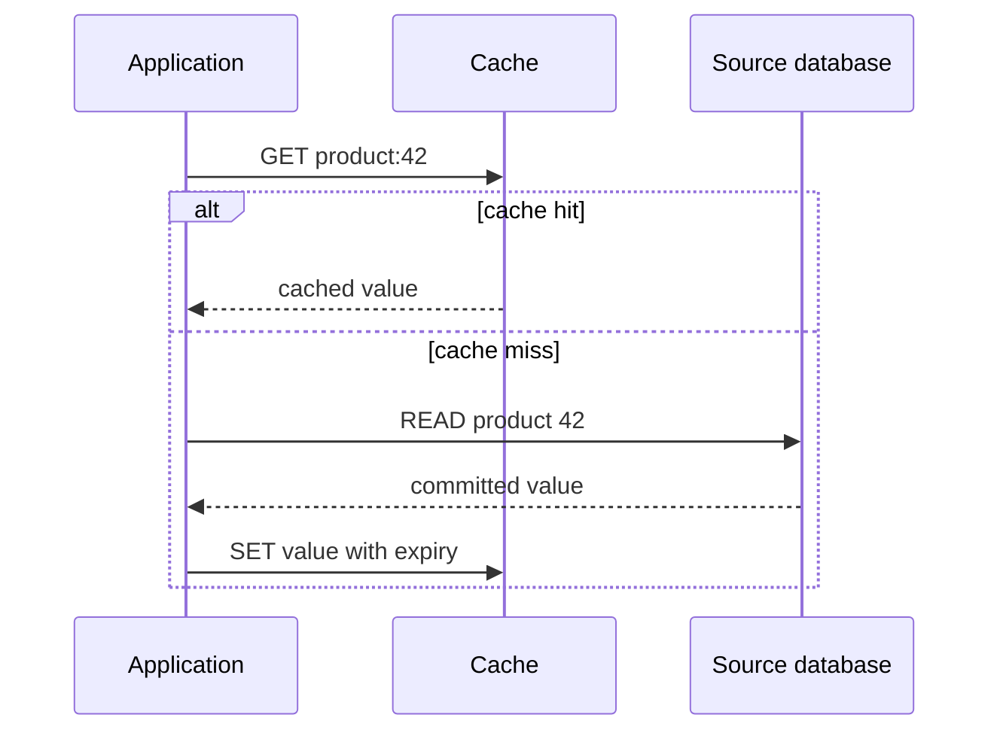

<div dir="rtl" align="right">

# ۰۱.۲ — الگوهای Cache-aside، Read-through و Write-through

**زبان:** فارسی · [English version](../../../../en/backend-performance/01-caching/02-cache-patterns/README.md)


**تاریخ بررسی منابع: ۲۰۲۶-۱۱-۱۰** · پیش‌نیاز: key/value، منبع اصلی داده و commit · موضوع قبلی پیشنهادی: [لایه‌های کش](../01-cache-layers/README.md).

## اصطلاح‌های لازم

**کلید** شناسه‌ای است که با آن مقدار کش را پیدا می‌کنیم؛ **hit/miss** به‌ترتیب پیدا شدن/نیافتن نسخهٔ قابل‌استفاده است. **منبع حقیقت** جایی است که تصمیم نهایی دربارهٔ داده از آن می‌آید. **Commit** یعنی تغییر از سوی منبع پایدار پذیرفته شده است. این واژه‌ها در بقیهٔ درس با همین معنا به کار می‌روند.

## هدف یادگیری و تعریف

پس از مطالعه می‌توانید مسئول cache miss را تعیین کنید، مسیر write را از read جدا طراحی کنید و توضیح دهید چرا «دو مقدار نوشته شد» به معنی تراکنش اتمیک میان پایگاه داده و کش نیست. الگوی کش قرارداد بین **برنامه، کش و منبع اصلی** است؛ نام یک ابزار، این قرارداد را تعیین نمی‌کند.

در این درس Cache-aside یعنی برنامه خودش cache lookup، بارگذاری از منبع و cache population را هماهنگ می‌کند. Read-through یعنی برنامه یک abstraction دارای loader را صدا می‌زند و آن لایه miss را از منبع تأمین می‌کند. Write-through یعنی write از مسیر واسط مشخص عبور می‌کند و پیش از موفقیت مطابق قرارداد، در منبع پایدار و کش اعمال می‌شود. نام‌گذاری پیاده‌سازی‌ها متفاوت است؛ قرارداد خطا و ترتیب را در مستند همان محصول بخوانید. [معرفی رسمی این خانواده الگوها: Azure Architecture Center](https://learn.microsoft.com/en-us/azure/architecture/patterns/cache-aside).

## مدل ذهنی و مقایسه

| الگو | مسئول miss در read | مسیر نوشتن در این درس | هزینه و خطر اصلی |
| --- | --- | --- | --- |
| Cache-aside | کد برنامه | commit منبع، سپس ابطال ورودی وابسته | کد تکراری، miss کندتر و پنجره ناسازگاری |
| Read-through | loader در لایه کش/کتابخانه | مستقل تعیین می‌شود؛ می‌تواند با write-through همراه باشد | وابستگی به قرارداد loader، مدیریت خطا و ابطال بیرون از آن |
| Write-through | الگوی read را تعیین نمی‌کند | واسط نوشتن، منبع و کش را پیش از تأیید هماهنگ می‌کند | افزایش کار مسیر write و مسئله شکست جزئی |

Read-through و Write-through دو محور متفاوت‌اند: اولی read را توصیف می‌کند و دومی write را. یک wrapper ساده می‌تواند Read-through فراهم کند؛ Redis معمولی خودبه‌خود از SQL شما خبر ندارد. همچنین Write-through با Write-behind فرق دارد: در Write-behind نوشتن منبع به بعد موکول می‌شود و دوام/بازپخش مسئله اصلی است؛ پیاده‌سازی آن خارج از این درس است. [مستند AWS ElastiCache درباره lazy loading و write-through](https://docs.aws.amazon.com/AmazonElastiCache/latest/dg/Strategies.html) برای دیدن هزینه miss و نوشتن داده‌ای که شاید هرگز خوانده نشود مناسب است.

<div dir="ltr" align="left">



</div>

نمودار متعلق به Cache-aside است. برای Read-through، بخش lookup و loader داخل abstraction قرار می‌گیرد؛ این جابه‌جایی مسئولیت، هزینه I/O منبع در miss را حذف نمی‌کند.

## چه زمانی انتخاب کنیم؟

Cache-aside برای نتیجه‌های پرتکرار که همه داده‌های منبع لازم نیست در حافظه جا شوند، نقطه شروع ساده‌ای است. اگر هر درخواست یک کلید جدید دارد، هزینه cache lookup و fill به miss افزوده می‌شود و سود کمی می‌گیرید. Read-through وقتی مفید است که قرارداد مشترک loader و خطا را در چند مصرف‌کننده یکدست می‌کند؛ loader نباید پنهانی queryهای بدون حد یا retry بی‌نهایت اجرا کند.

Write-through برای مسیرهایی قابل بررسی است که تمام writerها از واسط عبور می‌کنند و هزینه نوشتن بیشتر پذیرفته می‌شود. یک SQL job، migration یا سرویس دیگر که مستقیم منبع را تغییر می‌دهد، فرض آن را می‌شکند. حتی در Write-through، eviction و restart می‌تواند کش را خالی کند؛ برای read هنوز مسیر miss لازم است. برای مجوز دسترسی، موجودی قطعی یا محاسبات مالی، شرط درست‌بودن را با تراکنش/منبع معتبر بررسی کنید؛ hit کش به‌تنهایی تضمین تجاری نیست.

## مثال حل‌شده: توضیح عمومی کالا با Cache-aside

**فرض آموزشی:** توضیح کالا می‌تواند برای مدتی محدود قدیمی باشد و منبع اصلی پایگاه داده است. تمام اعداد پیکربندی نمونه‌اند. کلید شامل tenant و نسخه ساختار است؛ ابعاد دیگری مانند زبان، در صورت مؤثر بودن بر داده، باید اضافه شوند.

<div dir="ltr" align="left">

```text
function readProduct(tenantId, productId):
    authorizeRead(tenantId, productId)
    key = "product:v2:" + tenantId + ":" + productId
    cached = cache.tryGet(key, cacheTimeBudget)
    if cached.found:
        return cached.value

    # A cache error is distinct from an ordinary miss in metrics.
    value = source.readCommitted(tenantId, productId, sourceTimeBudget)
    cache.trySet(key, value, ttlSeconds=60)  # bounded best effort
    return value

function updateProduct(tenantId, productId, change):
    authorizeWrite(tenantId, productId)
    source.commitChange(tenantId, productId, change)
    cache.tryDelete("product:v2:" + tenantId + ":" + productId)
```

</div>

در read اول اگر کش خالی باشد، منبع خوانده می‌شود و نتیجه ۶۰ ثانیه نگه داشته می‌شود. read دوم پیش از انقضا می‌تواند hit باشد. بعد از commit نویسنده، حذف ورودی باعث می‌شود read بعدی دوباره منبع را ببیند. **این شبه‌کد عمداً یک پایه آموزشی با تضمین محدود است:** شکست delete باید ثبت و جبران شود؛ برای پاک‌شدن قابل اتکا می‌توان رخداد ابطال را همراه commit در outbox ثبت کرد و worker قابل retry داشت. نقش [کار پس‌زمینه](../../03-asynchronism/01-background-jobs/README.md) را آنجا مطالعه کنید.

ترتیب commit سپس delete، خطر پرشدن کش با داده هنوز commit‌نشده در فاصله حذف و commit را کم می‌کند، اما همه raceها را حل نمی‌کند. مثال مستقل: خواننده A نسخه ۷ را از منبع می‌گیرد، نویسنده B نسخه ۸ را commit و کلید را حذف می‌کند، سپس A نسخه ۷ را وارد کش می‌کند. در نتیجه تا ابطال بعدی یا expiry می‌توان داده قدیمی دید. برای تضمین قوی‌تر، بررسی نسخه/نسل، کنترل نوشتن fill و بازبینی مسیر خواندن لازم است؛ جزئیات در [ابطال و تازگی](../04-invalidation-and-freshness/README.md).

خطای کش با miss یکسان نیست: اگر تمام درخواست‌ها در خرابی کش مستقیم به منبع بروند، ممکن است ظرفیت منبع کافی نباشد. این مثال باید با سقف هم‌زمانی منبع، deadline و رفتار کاهش خدمت تکمیل شود؛ انتخاب سیاست بر اساس حساسیت داده است.

## تمرین کوچک و راه‌حل نمونه

یک جدول دستی با ستون‌های `source version`، `cache version` و «چه کسی پاسخ می‌دهد» بسازید:

۱. منبع نسخه ۷ و کش خالی است؛ دو read متوالی انجام دهید.

۲. نسخه ۸ را در منبع commit کنید ولی delete را به‌صورت عمدی ناموفق فرض کنید.

۳. یک read پیش از expiry و یک read پس از expiry انجام دهید.

۴. همین readها را به abstraction فرضی `getOrLoad(key, loader)` منتقل کنید و بنویسید کدام مسئولیت از caller حذف شد.

۵. برای Write-through فرض کنید commit موفق ولی cache write ناموفق شده است. قرارداد پاسخ API و retry را بنویسید.

**انتظار:** در مرحله اول یک بار خواندن منبع کافی است، در مرحله دوم کهنگی ظاهر می‌شود و در مرحله سوم expiry فرصت بارگذاری مجدد می‌دهد. جابه‌جایی به Read-through ناسازگاری write را خودبه‌خود برطرف نمی‌کند. در مرحله پنجم نمی‌توانید بگویید «هیچ اتفاقی نیفتاد»؛ منبع تغییر کرده است. retry بدون idempotency ممکن است اثر تجاری را تکرار کند. این تمرین محاسبه مسیر است، نه benchmark سرعت Redis.

## راه‌حل گام‌به‌گام تمرین

در read اول، خالی بودن کش باعث خواندن نسخهٔ ۷ از منبع و پرشدن کش می‌شود؛ read دوم همان نسخه را hit می‌کند. بعد از commit نسخهٔ ۸، اگر delete شکست بخورد، read پیش از انقضا هنوز می‌تواند نسخهٔ ۷ را بدهد. پس از expiry، read منبع را دوباره می‌خواند و نسخهٔ ۸ را می‌بیند، به شرط آنکه خود منبع تازه باشد. `getOrLoad` فقط مسئولیت lookup و loader را به abstraction می‌برد و پنجرهٔ ناسازگاری write را حل نمی‌کند. اگر Write-through منبع را commit کند و cache write شکست بخورد، منبع تغییر کرده است؛ خطا باید آشکار و قابل جبران باشد، و retry اثر را با کلید ثابت همان عملیات و قاعدهٔ idempotency تکرار نکند.

## تجربه عمومی مستند

> [گزارش مهندسی Meta در ۱۵ آوریل ۲۰۱۳](https://engineering.fb.com/2013/04/15/core-infra/scaling-memcache-at-facebook/) توضیح می‌دهد Facebook در سال ۲۰۰۵، در واکنش به رشد queryها و افزایش زمان بارگذاری صفحه، استفاده از memcached را آغاز کرد. همان گزارش به چالش‌های محبوبیت نامتوازن داده و fan-out اشاره می‌کند. این شاهد نقش عملی کش کنار منبع است؛ از متن کوتاه آن، نوع دقیق قرارداد Write-through یا تضمین اتمیک‌بودن نتیجه نمی‌گیریم. مقاله فنی پیوندشده در USENIX هنگام این بررسی با 403 قابل خواندن نبود؛ ادعاهای جزئی آن در این درس نقل نشده‌اند.

برداشت آموزشی ما این است که انتخاب الگو باید با تکرار read و هزینه منبع مرتبط باشد، نه فقط نام دیتابیس یا اندازه شرکت.

## شکست‌ها، سیگنال‌ها و چک‌لیست

| شکست | سیگنال قابل مشاهده | اقدام بررسی |
| --- | --- | --- |
| همه missها چند query اجرا می‌کنند | افزایش query به ازای درخواست و p95/p99 miss | loader را جدا trace کنید |
| حذف ناموفق پس از commit | اختلاف نسخه منبع/کش و خطای invalidation | ثبت رخداد، retry محدود و TTL پشتیبان |
| کلید بدون tenant یا schema version | اختلاط پاسخ یا خطای deserialize | طراحی namespace و سناریوی دو tenant |
| نویسنده بیرون از واسط | تغییر منبع بدون تغییر کش | فهرست همه writerها و مسیر انتشار تغییر |
| اشتباه missing با خرابی موقت | ذخیره «یافت نشد» هنگام timeout منبع | negative cache فقط برای نبود معتبر با TTL مشخص |

- [ ] منبع حقیقت و مسئول lookup/load/write برای هر الگو نوشته شده‌اند.
- [ ] miss، cache error، loader error و write error شمارنده جدا دارند.
- [ ] زمان انتظار کش و منبع محدود است؛ ظرفیت fallback بررسی شده است.
- [ ] cache fill دارای TTL و سقف اندازه است؛ نبود TTL تصمیم آگاهانه است.
- [ ] همه writerها و کلیدهای وابسته، شامل فهرست/جست‌وجو، شناخته شده‌اند.
- [ ] شکست جزئی write و پاسخ تکراری با idempotency سازگار است.
- [ ] مسیر ابطال ناموفق و خواننده هم‌زمان در تمرین بررسی شده‌اند.

## آزمون

۱. تفاوت تعیین‌کننده Cache-aside و Read-through چیست؟

۲. آیا انتخاب Read-through مشخص می‌کند write چگونه انجام شود؟

۳. چرا Write-through لزوماً به معنی تراکنش اتمیک SQL و کش نیست؟

۴. کدام داده از Cache-aside سود کمی می‌گیرد: کلیدهای پرتکرار یا نتیجه منحصربه‌فرد هر درخواست؟ چرا؟

۵. آیا commit سپس delete همه raceها را از بین می‌برد؟ یک ترتیب نقض‌کننده بنویسید.

۶. در خطای کش چرا «همه درخواست‌ها مستقیم به منبع بروند» تصمیم کافی نیست؟

### پاسخ تشریحی

۱. مالک منطق miss است: caller در Cache-aside و abstraction/loader در Read-through. تعداد I/O واقعی باید همچنان سنجیده شود.

۲. خیر؛ read و write دو قرارداد مستقل‌اند و می‌توانند ترکیب شوند. باید رفتار نوشتن و ابطال را جدا تعریف کرد.

۳. منبع و کش ممکن است دو سامانه مستقل با شکست جزئی باشند؛ موفقیت یکی و شکست دیگری بدون هماهنگی اضافه ممکن است.

۴. نتیجه یکتای هر درخواست؛ reuse کم است و lookup/fill سربار اضافه می‌کند.

۵. خیر؛ A نسخه ۷ را می‌خواند، B نسخه ۸ را commit و delete می‌کند، سپس A نسخه ۷ را fill می‌کند. کنترل نسخه و طراحی هم‌زمانی لازم است.

۶. چون بار miss ناگهانی ممکن است ظرفیت منبع را رد کند؛ سقف هم‌زمانی، deadline و رفتار خطا/کاهش خدمت باید مشخص باشند.

## جمع‌بندی

الگوی read مشخص می‌کند چه کسی miss را حل می‌کند؛ الگوی write مسیر تغییر را جدا تعریف می‌کند. Cache-aside ساده و صریح است، اما با commit، ابطال ناموفق، loader هم‌زمان و شکست جزئی باید برخورد کند؛ هیچ الگو جای منبع حقیقت و قرارداد سازگاری را نمی‌گیرد.

## منابع اختیاری و مرجع

تعریف و تحلیل هر الگو در خود صفحه آمده است؛ پیوندها برای مطالعهٔ بیشتر و مرجع قراردادهای ابزارها هستند.

- انگلیسی، معماری رسمی: [Microsoft Cache-aside pattern](https://learn.microsoft.com/en-us/azure/architecture/patterns/cache-aside)، برای مسئولیت برنامه، تازگی و محدودیت سازگاری.
- انگلیسی، راهنمای محصول: [AWS ElastiCache caching strategies](https://docs.aws.amazon.com/AmazonElastiCache/latest/dg/Strategies.html)، برای lazy loading، write-through و هزینه‌های آن‌ها؛ جزئیات محصول را از اصل الگو جدا کنید.
- انگلیسی، تجربه مهندسی: [Scaling memcache at Facebook](https://engineering.fb.com/2013/04/15/core-infra/scaling-memcache-at-facebook/)، برای زمینه استفاده و الگوی بار.
- انگلیسی، مستند رسمی: [Redis cache-aside](https://redis.io/docs/latest/develop/use-cases/cache-aside/)، برای بارخوانی cache-on-miss، TTL، حذف در زمان نوشتن و کنترل stampede؛ API و پیاده‌سازی آن Redis-specific هستند.
- انگلیسی، الگوی مرتبط با سازگاری نوشتن: [AWS Transactional Outbox](https://docs.aws.amazon.com/prescriptive-guidance/latest/cloud-design-patterns/transactional-outbox.html)، برای انتشار قابل اتکای رویداد پس از commit؛ به‌تنهایی الگوی cache یا تضمین تازگی cache نیست.
- فارسی، آموزش مکمل: [DevNA: راهنمای cache-aside، TTL و سیاست حذف](https://devna.ir/articles/redis-caching-guide)، برای مرور واژگان و نمونه برنامه؛ اعداد آزمایش آن مرجع ظرفیت سامانه شما نیستند.

[فهرست فصل](../README.md) · [فهرست مجموعه](../../README.md) · [درس قبل: لایه‌ها](../01-cache-layers/README.md) · [درس بعد: کش چندسطحی](../03-multi-level-caching/README.md) · [مرتبط: مهلت و retry](../../06-code-optimization/07-timeouts-and-retries/README.md)

</div>
