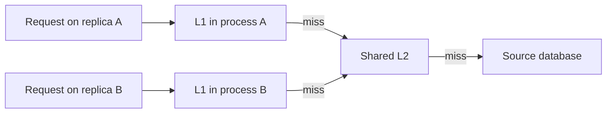

<div dir="rtl" align="right">

# ۰۱.۳ — کش چندسطحی و هماهنگی نسخه‌ها

**زبان:** فارسی · [English version](../../../../en/backend-performance/01-caching/03-multi-level-caching/README.md)


**تاریخ بررسی منابع: ۲۰۲۶-۱۱-۱۰** · پیش‌نیاز: [الگوهای کش](../02-cache-patterns/README.md)، چند نمونه برنامه و تفاوت حافظه محلی و شبکه.

## هدف یادگیری و تعریف

پس از این درس می‌توانید مسیر `L1 → L2 → source` را طراحی کنید، hit هر سطح را با مخرج درست حساب کنید و نشان دهید چرا پاک‌کردن کش مشترک، حافظه همه فرایندها را پاک نمی‌کند. **کش چندسطحی** یعنی چند محل reuse پشت سر هم با سرعت، اندازه و دامنه اشتراک متفاوت. در این درس L1 حافظه محلی برنامه و L2 کش مشترک روی شبکه است؛ این نام‌ها به کش سخت‌افزاری CPU اشاره ندارند.

لایه‌های HTTP و CDN در [درس لایه‌ها](../01-cache-layers/README.md) معرفی شدند. اینجا تمرکز بر حافظه محلی چند replica برنامه و کش داده مشترک است، نه انتخاب محل CDN.

## واژه‌های پایه

**Replica** یک نمونهٔ جداگانه از برنامه است که حافظهٔ محلی مستقل دارد. **L1** در این درس همان حافظهٔ همان نمونه است و **L2** کش شبکه‌ای مشترک؛ حذف مقدار از L2، حافظهٔ replicaها را خودکار تغییر نمی‌دهد. TTL مدت مجاز reuse در قرارداد این ورودی است و با عمر باقی‌ماندهٔ نسخه سنجیده می‌شود.

## مدل ذهنی و مراحل read

<div dir="ltr" align="left">



</div>

۱. برنامه پس از کنترل دسترسی، ورودی L1 را همراه نسخه و deadline تازگی بررسی می‌کند.

۲. در miss به L2 می‌رود؛ در hit داده را با **عمر باقی‌مانده** به L1 منتقل می‌کند.

۳. اگر L2 نیز miss باشد، مسیر بارگذاری منبع با بودجه زمان و سقف هم‌زمانی اجرا می‌شود؛ نتیجه در لایه‌های مناسب قرار می‌گیرد.

۴. با تغییر منبع، باید هم L2 و هم همه نسخه‌های L1 مرتبط ابطال یا به‌روز شوند؛ ترتیب commit و fillهای درحال اجرا نیز اهمیت دارد.

داشتن L1 می‌تواند تماس شبکه در hit را حذف کند. در مقابل، هر replica نسخه و مصرف حافظه خود را دارد؛ افزایش تعداد replicaها باعث تکثیر همان داده می‌شود. تجربه عملیاتی [Amazon درباره local و external cache](https://aws.amazon.com/builders-library/caching-challenges-and-strategies/) به ناسازگاری میان سرورها و cold start محلی اشاره می‌کند؛ این هزینه‌ها را قبل از اضافه‌کردن سطح دوم بسنجید.

## trade-off و انتخاب دامنه

| انتخاب | مزیت محتمل | هزینه/شرط |
| --- | --- | --- |
| تنها L2 مشترک | یک محل مشترک برای reuse بین replicaها | هر read هنوز تماس شبکه دارد |
| L1 کوچک + L2 | کاهش تماس‌های تکراری به L2 برای داده داغ | مصرف حافظه تکراری، ابطال و نسخه‌های محلی |
| L1 کوتاه‌عمر بدون پیام | پیاده‌سازی ساده‌تر برای داده تحمل‌پذیر | پذیرفتن پنجره کهنگی؛ به معنی coherence قوی نیست |
| L1 با پیام ابطال | واکنش سریع‌تر به تغییر در حالت سالم | تأخیر/گم‌شدن پیام و race با fill باید مدیریت شود |

برای هر request با نتیجه یکتا، L1 فقط هزینه نگهداری اضافه می‌کند. برای داده بسیار حساس به تغییر، حذف سطح محلی ممکن است از افزودن پروتکل هماهنگی بهتر باشد. افزایش hit را همراه سن داده و p95/p99 بسنجید؛ hit بیشتر با پاسخ کهنه موفقیت محصول نیست.

## مثال حل‌شده: hit مشروط و عمر واقعی

**مدل آموزشی، نه نتیجه شرکت:** در ۱۰۰۰ درخواست، L1 برای ۸۰۰ مورد hit دارد. از ۲۰۰ درخواست باقی‌مانده، L2 برای ۱۵۰ مورد hit دارد. پس ۵۰ read به منبع می‌رسد.

<div dir="ltr" align="left">

```text
L1 hit ratio                  = 800 / 1000 = 0.80
L2 conditional hit ratio      = 150 / 200  = 0.75
Overall cache hit ratio       = (800 + 150) / 1000 = 0.95
Source request fraction       = (1 - 0.80) * (1 - 0.75) = 0.05
```

</div>

نمی‌توان ۸۰٪ و ۷۵٪ را جمع کرد؛ مخرج آن‌ها متفاوت است. این مدل به read عادی بدون retry، refresh اضافی، coalescing یا خطا مربوط است. در سامانه واقعی تعداد queryها را مستقیم هم بشمارید؛ نرخ cache miss همیشه برابر نرخ query نیست.

حالا ورودی در زمان ۰ از منبع گرفته شده و `validUntil=60` دارد. replica B در ثانیه ۵۵ از L2 می‌خواند. اگر برای L1 دوباره TTL کامل ۶۰ ثانیه بگذارد، داده می‌تواند تا ثانیه ۱۱۵ در حافظه محلی باقی بماند، در حالی که بودجه مدل ۶۰ بود. قاعده نمونه درست این است:

<div dir="ltr" align="left">

```text
remaining = entry.validUntil - now
if remaining <= 0:
    doNotPromoteToL1()
else:
    localTtl = min(configuredL1Ttl, remaining)
    putL1(entry.value, entry.version, localTtl)
```

</div>

برای پیاده‌سازی واقعی، زمان‌های absolute میان ماشین‌ها به همگامی ساعت و حاشیه اطمینان نیاز دارند؛ یا عمر باقی‌مانده را با احتساب زمان انتقال منتشر کنید. expiry کش، سن نسخه پایگاه داده را به‌تنهایی ثابت نمی‌کند: ممکن است منبع خواندن replica عقب‌مانده باشد. قاعده بالا فقط جلوی تمدید ناخواسته عمر در زنجیره این مثال را می‌گیرد.

## ابطال بین replicaها و قطع ارتباط

پس از تغییر منبع، حذف L2 برای A و B پیام خودکار نیست. می‌توان رخداد `product:42 changed to version 8` منتشر کرد و همه L1ها را پاک کرد. در Redis Pub/Sub تحویل **at-most-once** است؛ مشترکی که هنگام پیام قطع بوده، آن را بعداً بازپخش نمی‌گیرد. بنابراین صرف استفاده از Pub/Sub تضمین دریافت همه ابطال‌ها نیست. [مستند رسمی semantics](https://redis.io/docs/latest/develop/pubsub/#delivery-semantics).

برای طرحی که کهنگی محدود می‌خواهد، TTL پشتیبان، پاک‌کردن L1 هنگام reconnect و تشخیص شکاف ارتباط را تعریف کنید. برای تحویل قابل بازپخش، باید سامانه رخداد دارای نگهداری، cursor و جبران را طراحی کنید؛ فقط تغییر نام broker کافی نیست. حتی با پیام سالم، fill قدیمی ممکن است بعد از رسیدن ابطال تمام شود. نسخه/نسل محلی و کنترل انتشار fill باید مانع بازگشت نسخه قدیمی شود، یا باید این پنجره را صریحاً بپذیرید.

## تمرین کوچک و راه‌حل نمونه

بدون ابزار هم می‌توانید دو جدول `L1-A` و `L1-B` و یک جدول `L2` بسازید:

۱. همه را با نسخه ۷ پر کنید؛ A و B هر کدام read دارند.

۲. منبع را نسخه ۸ کنید، L2 را پاک کنید و تنها L1-A را پاک کنید.

۳. یک read به A و یک read به B بفرستید. بعد عمر L1-B را تمام کنید و دوباره بخوانید.

۴. حالت پیام ابطال را اضافه کنید ولی B را هنگام ارسال قطع فرض کنید؛ پس از reconnect ابتدا L1 آن را پاک کنید.

۵. نمونه محاسبه hit را با L1 برابر ۶۰۰ از ۱۰۰۰ و L2 برابر ۳۲۰ از ۴۰۰ تکرار کنید.

**انتظار:** در مرحله دوم B هنوز می‌تواند نسخه ۷ بدهد؛ load balancer ممکن است کاربر را بین نسخه‌ها جابه‌جا کند. reconnect همراه flush، امکان reuse نسخه محلی نامطمئن را می‌گیرد ولی بار warm-up ایجاد می‌کند. در مرحله پنجم overall hit برابر ۹۲٪ و read منبع ۸۰ است. این تمرین به‌تنهایی اثبات coherence خطی‌پذیر نیست.

## راه‌حل گام‌به‌گام تمرین

پس از پاک‌کردن L2 و فقط `L1-A`، هر دو کش A و B رفتار متفاوت دارند: A به منبع/نسخهٔ جدید می‌رسد، ولی B هنوز می‌تواند نسخهٔ ۷ را از حافظهٔ خودش بدهد. قطع B هنگام پیام ابطال همین اختلاف را حفظ می‌کند؛ flush هنگام reconnect نسخهٔ نامطمئن را حذف می‌کند و در عوض cold miss می‌سازد. در محاسبهٔ جدید، `L1=600/1000=60%` و `L2=320/400=80%` از missهای L1 است؛ پس منبع `400×(1−0.8)=80` درخواست، یا ۸٪ کل، می‌بیند و overall hit برابر ۹۲٪ است. در `t=55` از deadline شصت‌ثانیه‌ای فقط پنج ثانیه باقی است؛ پروموشن به L1 باید TTL حداکثر پنج‌ثانیه‌ای بگیرد.

## شاهد عمومی: کش محلی با کمک سرور Redis

> **مستند عملیاتی رسمی، بدون ادعای benchmark:** [Redis client-side caching](https://redis.io/docs/latest/develop/clients/client-side-caching/) طرحی واقعی از حافظه کلاینت کنار سرور Redis را توضیح می‌دهد: سرور کلیدهای خوانده‌شده را track می‌کند و با تغییرشان invalidation می‌فرستد؛ کلاینت ورودی نامعتبر را کنار می‌گذارد. همان مستند به رفتار پاک‌سازی کش در قطع connection و لزوم پشتیبانی کتابخانه اشاره می‌کند. این «کلاینت» می‌تواند کتابخانه داخل backend باشد، نه مرورگر کاربر. این شاهد سازوکار L1 نزدیک مصرف‌کننده است؛ جای ابطال SQL به Redis یا تضمین همه حالت‌های هم‌زمانی برنامه شما را نمی‌گیرد.

قبل از فعال‌کردن این قابلیت، نسخه Redis، پروتکل، کتابخانه و رفتار connection pool خود را با مستند همان نسخه بررسی کنید؛ پشتیبانی یک فرمان به‌تنهایی معادل پشتیبانی کامل client-side caching نیست.

## شکست‌ها و سیگنال‌های عملیاتی

| شکست | نشانه | چه چیزی بررسی شود؟ |
| --- | --- | --- |
| بازگشت داده قدیمی در یک replica | اختلاف نسخه در پاسخ‌های متوالی | نسخه پاسخ به همراه شناسه replica، بدون ثبت اطلاعات حساس |
| L1 بدون سقف اندازه | رشد heap، فشار GC یا OOM | اندازه/تعداد ورودی، محدودیت حافظه و eviction محلی |
| rollout هم‌زمان همه replicaها | جهش miss و ترافیک L2/منبع | rollout تدریجی، ظرفیت cold start و coalescing |
| تمدید عمر در promotion | سن داده بیشتر از بودجه محصول | metadata عمر اولیه و باقی‌مانده |
| گم‌شدن ابطال | اختلاف پایدار پس از reconnect | شکاف پیام، flush و مسیر جبران |

## چک‌لیست عملیاتی

- [ ] دلیل قابل اندازه‌گیری برای اضافه‌کردن L1 وجود دارد.
- [ ] L1 و L2 هرکدام سقف اندازه، سیاست eviction و TTL دارند.
- [ ] hit ratioها با مخرج جدا و نرخ واقعی دسترسی منبع گزارش می‌شوند.
- [ ] نسخه و عمر با عبور بین سطح‌ها بی‌دلیل تمدید نمی‌شوند.
- [ ] همه replicaها و writerها در طرح ابطال دیده شده‌اند.
- [ ] قطع ارتباط، reconnect و fill قدیمی هم‌زمان با ابطال بررسی شده‌اند.
- [ ] cold start و از دست رفتن L2 به burst نامحدود منبع تبدیل نمی‌شود.
- [ ] نمونه‌برداری سن/نسخه داده کنار تأخیر انجام می‌شود.

## آزمون

۱. L1 و L2 در این درس به چه محل‌هایی اشاره دارند؟

۲. چرا حذف کلید L2، کلید L1-B را الزاماً حذف نمی‌کند؟

۳. اگر L1 hit برابر ۶۰٪ و L2 hit مشروط برابر ۸۰٪ باشد، چند درصد درخواست‌ها به منبع می‌رسند؟

۴. چرا انتقال ورودی در ثانیه ۵۵ با TTL تازه ۶۰ می‌تواند غلط باشد؟

۵. آیا Pub/Sub عادی Redis پیام قطع‌شده را بعد از reconnect بازپخش می‌کند؟

۶. آیا TTL کوتاه‌تر L1 تضمین می‌کند هیچ پاسخ کهنه‌ای تولید نشود؟

### پاسخ تشریحی

۱. حافظه محلی هر فرایند و کش مشترک روی شبکه؛ این‌ها در این متن نام کش CPU نیستند.

۲. حافظه فرایند B جداست؛ بدون پیام، expiration یا قرارداد دیگر از حذف L2 خبردار نمی‌شود.

۳. `0.40 × 0.20 = 0.08` یا ۸٪؛ overall hit برابر ۹۲٪ است. L2 فقط درخواست‌های عبورکرده از L1 را می‌بیند.

۴. چون ۵ ثانیه از عمر تعیین‌شده باقی مانده است؛ TTL جدید می‌تواند عمر داده را تا ۱۱۵ تمدید کند. باید از باقی‌مانده و سقف L1 استفاده شود.

۵. خیر؛ at-most-once است. برای نسخه‌های نامطمئن باید flush، TTL یا طرح قابل بازپخش/جبران داشت.

۶. خیر؛ فقط پنجره reuse را تحت فرض‌های مشخص کم می‌کند. منبع عقب‌مانده، fill قدیمی یا تأخیر ابطال همچنان مسئله‌اند.

## جمع‌بندی

L1 فقط وقتی ارزش دارد که هزینهٔ شبکهٔ L2 قابل‌اندازه‌گیری باشد و تازگی موردنیاز اجازهٔ نسخه‌های محلی را بدهد. نرخ hit را با مخرج شرطی درست حساب کنید، عمر را هنگام promotion تمدید نکنید و قطع پیام و cold start را در ظرفیت منبع بگنجانید.

## منابع اختیاری و مرجع

تمام محاسبات و مسیرها در این صفحه آمده‌اند؛ این منابع برای تعمیق و بررسی رفتار پیاده‌سازی مشخص‌اند.

- انگلیسی، مستند اصلی: [Redis client-side caching](https://redis.io/docs/latest/develop/clients/client-side-caching/)، برای tracking، ابطال، قطع ارتباط و سازگاری کلاینت.
- انگلیسی، قرارداد تحویل: [Redis Pub/Sub](https://redis.io/docs/latest/develop/pubsub/)، برای دیدن محدودیت at-most-once.
- انگلیسی، تجربه عملیاتی: [Amazon caching challenges](https://aws.amazon.com/builders-library/caching-challenges-and-strategies/)، بخش local و external caches برای فهم چندنسخه‌ای و cold start.
- انگلیسی، فرمان رسمی: [Redis CLIENT TRACKING](https://redis.io/docs/latest/commands/client-tracking/)، برای ابطال server-assisted در cache سمت client.
- انگلیسی، راهنمای معماری رسمی: [Azure caching best practices](https://learn.microsoft.com/en-us/azure/architecture/best-practices/caching)، برای انتخاب محدوده cache محلی/مشترک؛ این راهنما تضمین سازگاری Redis یا محصول دیگری نیست.
- فارسی، پیش‌نیاز مرتبط: [نت پارادیس: Redis، الگوهای کش و انقضا](https://netparadis.com/redis-data-types-caching-strategy/)، برای مرور کش مشترک و TTL با مثال Node.js. این منبع آموزش کامل پروتکل L1/L2 نیست؛ در منابع فارسی قابل خواندن این بررسی، مرجع مستقلی با پوشش تمام حالت‌های قطع ارتباط و fill هم‌زمان پیدا نشد. توضیح فارسی همین درس و مستند رسمی Redis مرجع این بخش‌اند.

[فهرست فصل](../README.md) · [فهرست مجموعه](../../README.md) · [درس قبل: الگوها](../02-cache-patterns/README.md) · [درس بعد: ابطال و تازگی](../04-invalidation-and-freshness/README.md) · [مرتبط: load balancing](../../05-load-balancing-and-scaling/02-load-balancing/README.md)

</div>
