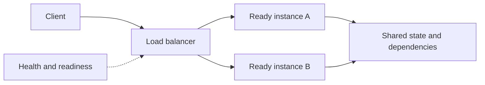

<div dir="rtl" align="right">

# ۵.۲ توزیع بار — Load Balancing

**زبان:** فارسی · [English version](../../../../en/backend-performance/05-load-balancing-and-scaling/02-load-balancing/README.md)


**Load Balancing** انتخاب یک مقصد مناسب از میان چند نمونه برای اتصال یا درخواست ورودی است. ظرفیت موجود زمانی قابل استفاده می‌شود که مقصد آماده باشد، انتخاب با نوع بار تناسب داشته باشد و State درخواست اجازه جابه‌جایی بدهد. Load Balancer به‌تنهایی نمونه جدید نمی‌سازد و توان پایگاه داده مشترک را افزایش نمی‌دهد.

**تاریخ بررسی منابع: <span dir="ltr">2026-11-10</span>.** این درس وابسته به زبان یا محصول خاص نیست؛ رفتارهای مختص محصول صریحاً با نام همان محصول آمده‌اند.

## خروجی یادگیری

- تفاوت تصمیم بر اتصال در لایه ۴ و تصمیم آگاه از HTTP در لایه ۷ را توضیح می‌دهید.
- Round Robin، Weighted، Least Connections و Hash/Affinity را با هزینه‌هایشان مقایسه می‌کنید.
- Health Check، Readiness و Drain را در ورود و خروج نمونه به‌کار می‌گیرید.
- اثر نشست، اتصال طولانی، Retry، صف و همسایه پرمصرف را روی تعادل واقعی می‌سنجید.
- خرابی Load Balancer و رفتار نبودن مقصد سالم را در طراحی وارد می‌کنید.

## مدل ذهنی: انتخاب مقصد، سپس کنترل کار



در شکل، سالم‌بودن A و B به معنی ظرفیت بی‌نهایت S نیست. نمونه تازه ابتدا ثبت و آماده می‌شود؛ سپس در تصمیم توزیع شرکت می‌کند. برای خروج، ابتدا پذیرش کار تازه متوقف و بعد کار جاری تخلیه می‌شود. این توالی با [مقیاس‌دهی افقی](../01-horizontal-and-vertical-scaling/README.md) همکاری می‌کند، اما تصمیم افزایش تعداد نمونه‌ها جداست.

### لایه انتخاب و طول عمر اتصال

در **لایه ۴**، مسیریابی معمولاً بر اطلاعات شبکه و انتقال مثل IP، پورت و پروتکل بنا می‌شود؛ جریان TCP یا UDP به مقصدی نگاشت می‌شود. در **لایه ۷**، پراکسی HTTP می‌تواند بر اساس Host، مسیر، Header یا Cookie تصمیم بگیرد. مشاهده محتوای HTTPS مستلزم پایان‌دادن TLS در نقطه مناسب است و برای مسیر تا Backend هم باید سیاست رمزنگاری و اعتماد مشخص باشد.

واحد انتخاب را از مستندات پیاده‌سازی بخوانید. یک اتصال HTTP/2 می‌تواند چند درخواست هم‌زمان حمل کند؛ یک WebSocket ممکن است ساعت‌ها باز بماند. شمارش برابر اتصال، تضمین کار برابر نیست و افزودن سرور تازه، اتصال‌های قدیمی را لزوماً بین سرورها بازتوزیع نمی‌کند.

## الگوریتم‌ها و مصالحه‌ها

| روش | منطق انتخاب | کاربرد و محدودیت |
| --- | --- | --- |
| Round Robin | انتخاب نوبتی مقصدها | شروع ساده برای مقصدهای مشابه و کارهای نزدیک به هم؛ هزینه درخواست و وضعیت لحظه‌ای را مستقیم نمی‌سنجد |
| Weighted Round Robin | سهم بیشتر برای مقصد دارای وزن بالاتر | ظرفیت‌های متفاوت؛ وزن باید اندازه‌گیری و بعد از تغییر منابع بازبینی شود |
| Least Connections | مقصد با اتصال فعال کمتر | اتصال‌های با مدت متفاوت؛ اتصال کم الزاماً CPU یا درخواست هم‌زمان کم نیست |
| Hash / Affinity | نگاشت کلید مثل Cookie یا IP به مقصد | ثبات مسیر و بعضی نیازهای State/Cache؛ کلید داغ، NAT و تغییر مجموعه مقصد می‌تواند عدم توازن بسازد |

این تعریف روش‌ها و امکان تغییر مقصد درخواست بعدی با [مستند رسمی NGINX](https://nginx.org/en/docs/http/load_balancing.html) سازگار است. **هیچ الگوریتمی هزینه همه کارها را از پیش نمی‌داند.** اگر یک Tenant گزارش بسیار سنگین می‌سازد، وزن‌دهی عمومی یا Hash به‌تنهایی عدالت ایجاد نمی‌کند؛ سهمیه، محدودیت هم‌زمانی یا Pool جداگانه می‌تواند لازم باشد.

### State و Sticky Session

اگر ورود کاربر در حافظه A ذخیره شده باشد، درخواست بعدی به B ممکن است ناشناخته شود. Affinity این مسئله را تا زمانی که A در دسترس باشد کاهش می‌دهد، ولی ماندگاری یا Failover نشست نمی‌سازد. IP Hash پشت NAT نیز می‌تواند کاربران زیادی را روی یک نمونه متمرکز کند. نگهداری مناسب State در منبع مشترک، آزادی انتخاب مقصد را افزایش می‌دهد؛ هزینه تأخیر، دسترس‌پذیری و سازگاری آن منبع باید محاسبه شود. برای تماس زنده یا اتصال طولانی، ممکن است State ذاتاً به یک میزبان وابسته باشد و انتقال به پروتکل بازیابی/اتصال مجدد نیاز داشته باشد.

## Health Check و چرخه عمر مقصد

**Active Check** به‌طور دوره‌ای Probe می‌فرستد؛ **Passive Check** از خطای ترافیک واقعی برای تشخیص مشکل استفاده می‌کند. بازبودن پورت فقط رسیدن به فرایند را نشان می‌دهد؛ **Readiness** می‌پرسد آیا نمونه همین حالا می‌تواند کار واقعی مورد انتظار را قبول کند. Readiness و Liveness فرایند را یکسان نگیرید: Restart مداوم یک فرایند به علت قطع وابستگی مشترک می‌تواند بازیابی را بدتر کند.

Health Check باید کم‌هزینه، دارای Timeout و معنی موفقیت مشخص باشد. فاصله و آستانه شکست، سرعت تشخیص را در برابر حذف اشتباه مقصد معامله می‌کنند. Probe عمیقی که خرابی DB مشترک را به ناسالم‌شدن هم‌زمان همه APIها تبدیل کند، باید با سیاست پذیرش/رد بار و بازیابی هماهنگ باشد. سلامت مسیر کاربر را با شاخص واقعی یا درخواست مصنوعی هم بسنجید.

رفتار «همه مقصدها ناسالم‌اند» همگانی نیست: [AWS Application Load Balancer](https://docs.aws.amazon.com/elasticloadbalancing/latest/application/target-group-health-checks.html) مستند می‌کند اگر همه مقصدهای ثبت‌شده ناسالم شوند، در شرایط شرح‌داده‌شده **Fail Open** می‌کند و به آن‌ها ترافیک می‌فرستد. بنابراین از Health Check، قطع قطعی ترافیک به همه مقصدهای ناسالم را استنتاج نکنید؛ سیاست محصول خود را بررسی کنید.

برای Deploy یا Scale In، مقصد را وارد **Drain** کنید: کار تازه نگیرد، اتصال‌ها/کار جاری تا مهلت مشخص تکمیل شوند، سپس متوقف شود. برای WebSocket و کار بلندمدت، مهلت بی‌نهایت قابل اتکا نیست؛ قطع کنترل‌شده و بازیابی را طراحی کنید.

## مثال حل‌شده: تعداد درخواست برابر، مصرف برابر نیست

این سناریو **فرض آموزشی** است. A و B هرکدام یک Worker تک‌کاره دارند. شش کار با ترتیب ورود زیر در زمان صفر در صف مقصد قرار می‌گیرند؛ هزینه، زمان خدمت است و شبکه و سربار را صفر فرض می‌کنیم.

<div dir="ltr" align="left">

```text
jobs (ms): 100, 10, 100, 10, 100, 10
round robin:
  A -> jobs 1, 3, 5 -> finish at 100, 200, 300 ms
  B -> jobs 2, 4, 6 -> finish at 10, 20, 30 ms
```

</div>

هر مقصد سه درخواست دارد، ولی A ده برابر B کار می‌کند. صف A تا ۳۰۰ میلی‌ثانیه باقی می‌ماند. تغییر به Least Connections **تضمین حل این مثال نیست**: شمارنده اتصال باید بار درحال اجرای واقعی را نمایندگی کند؛ در ورود هم‌زمان یا اتصال‌های Multiplexed، این مشاهده ممکن است کافی نباشد. با تغییر ترکیب بار، صف مقصد و صدک تأخیر را مقایسه کنید.

مثال ظرفیت جدا: A ظرفیت پایدار ۱۰۰ و B ظرفیت ۲۰۰ درخواست سبک در ثانیه دارد. بار ۲۴۰ با وزن برابر تقریباً ۱۲۰ به هرکدام می‌دهد و A از ظرفیتش می‌گذرد. وزن `1:2` در توزیع بلندمدت تقریباً `80:160` می‌دهد. این نتیجه به همسان‌بودن نوع کار و نبود محدودیت مشترک وابسته است. اگر B خراب شود، ظرفیت ۱۰۰ باقی می‌ماند و تغییر الگوریتم بار ۲۴۰ را قابل تحمل نمی‌کند؛ محدودسازی پذیرش یا ظرفیت جایگزین لازم است.

## تمرین کوچک و مشاهده مورد انتظار

روی کاغذ یا در یک محیط محلی آموزشی:

۱. مثال شش کار را با ترتیب `100, 100, 100, 10, 10, 10` دوباره توزیع و مجموع زمان خدمت هر مقصد را حساب کنید.

۲. در مثال A/B وزنی، B را از مجموعه سالم حذف کنید. ظرفیت باقیمانده، بار اضافه و واکنش مناسب را بنویسید.

۳. یک نشست محلی روی B فرض کنید؛ توضیح دهید پس از حذف B چه داده‌ای برای ادامه کار لازم است و کجا باید وجود داشته باشد.

**انتظار:** در حالت اول A مجموع ۲۱۰ و B مجموع ۱۲۰ میلی‌ثانیه کار می‌گیرند؛ ترتیب و ترکیب بار نتیجه را تغییر می‌دهد. در حالت دوم، ۱۴۰ درخواست در ثانیه بیش از ظرفیت باقی‌مانده است. Health Check مشکل را کشف می‌کند، ولی منابع ایجاد نمی‌کند. در حالت سوم، بدون State قابل بازیابی یا منبع مشترک، ادامه نشست تضمین ندارد. این تمرین نتیجه اجرای یک Load Balancer واقعی گزارش نمی‌کند.

## شواهد واقعی: جای‌گذاری تماس در Discord

> **گزارش دست‌اول، ۹ ژوئن ۲۰۲۶:** Discord در [مهاجرت Voice به Edge](https://discord.com/blog/how-we-moved-discord-voice-to-the-edge) می‌گوید هر تماس یک نمونه SFU دارد و تمام شرکت‌کنندگان در طول تماس به همان میزبان وصل‌اند. آزمایش ایسلند برای تماس‌های محلی بهتر شد، اما کاربران غیرمحلی در تماس‌های مختلط مسیر بدتری پیدا کردند؛ انتخاب میزبان باید ترکیب شرکت‌کنندگان را لحاظ می‌کرد. این تیم در اروپا هم تأخیر ناشی از گرسنگی ارسال در برنامه و رقابت Softirq روی vCPU را بررسی و اصلاح کرد.
>
> **برداشت آموزشی و حد شواهد:** مقصد نزدیک‌تر یا نمونه بیشتر، جای انتخاب مقصد مناسب و بررسی صف/زمان‌بندی را نمی‌گیرد. این تجربه درباره جای‌گذاری تماس Stateful است؛ شاهد مقایسه Round Robin و Least Connections در HTTP نیست و نتیجه آن به API عادی تعمیم عددی داده نمی‌شود. برای رفتار الگوریتم‌ها، مرجع رسمی بالا را ببینید.

## Retry، صف و شکست‌های رایج

اگر پراکسی بعد از Timeout درخواست را به مقصد دیگر بفرستد، نمونه قبلی ممکن است هنوز درحال کار یا حتی Commit کرده باشد. برای عملیات تغییردهنده State، انتخاب مقصد جدید بدون Idempotency می‌تواند اثر تکراری بدهد. بودجه زمانی سرتاسری، محدودیت تعداد تلاش، Backoff/Jitter و یک محل روشن برای Retry لازم است. صف نامحدود در پراکسی یا Backend نیز کار پذیرفته‌شده را آن‌قدر عقب می‌اندازد که کلاینت Timeout و Retry کند. [شرح AWS درباره Load Shedding](https://aws.amazon.com/builders-library/using-load-shedding-to-avoid-overload/) ارتباط اضافه‌بار، تلاش مجدد و افت کار موفق را توضیح می‌دهد.

| خطا | سیگنال | بررسی/کنترل |
| --- | --- | --- |
| Health Check همیشه ۲۰۰ می‌دهد ولی کار شکست می‌خورد | خطای مسیر واقعی با مقصدهای Healthy | Readiness معنادار و پایش سرتاسری |
| حذف سریع مقصدها در جهش کوتاه | Flapping و بار ناگهانی روی باقیمانده | آستانه، Timeout، ظرفیت خرابی و سیاست بازیابی |
| توزیع مساوی به ظرفیت نامساوی | p99 بالای یک مقصد، دیگری کم‌کار | وزن مبتنی بر ظرفیت و ترکیب بار |
| شمارش اتصال به‌جای کار واقعی | اتصال مشابه ولی صف/CPU متفاوت | درخواست فعال، صف و زمان خدمت هر مقصد |
| یک Tenant همه منابع را می‌گیرد | شاخص کلی مناسب، تأخیر بقیه Tenantها بد | سهمیه و Pool/صف مجزا برای بار حساس |
| خود Load Balancer گلوگاه یا نقطه خرابی است | Backend خلوت، خطا/صف در ورودی | توان اتصال، TLS، شبکه، افزونگی و Failover ورودی |

## چک‌لیست عملیاتی

- [ ] واحد انتخاب، پروتکل، TLS و نیاز Affinity مشخص است.
- [ ] ظرفیت و وزن مقصدها با بار نماینده سنجیده شده است.
- [ ] نرخ کار، p95/p99، خطا، اتصال فعال و صف هر مقصد جدا دیده می‌شود.
- [ ] Probe، Timeout، آستانه‌ها و رفتار نبود مقصد سالم مشخص‌اند.
- [ ] ورود آماده، گرم‌شدن و Drain خروج آزمایش‌پذیر تعریف شده‌اند.
- [ ] نشست و اتصال بلندمدت مسیر بازیابی دارند.
- [ ] سقف هم‌زمانی/صف، بودجه Retry و Idempotency عملیات حساس روشن است.
- [ ] افزونگی ورودی و ظرفیت باقیمانده پس از خرابی با هدف سرویس سازگار است.

## پیش‌نیازها و حل قدم‌به‌قدم توزیع

مقصد آماده backendی است که اکنون می‌تواند قرارداد درخواست را بپذیرد؛ Health Check مشاهده‌ای از یک شرط محدود است، نه اثبات همه مسیرهای کاربر. Affinity کلید را به مقصدی ترجیحی نگاشت می‌کند و Drain مقصد را از کار تازه خارج می‌کند تا کار جاری فرصت پایان یا بازیابی داشته باشد. Load Balancer مقصد را برمی‌گزیند؛ Scale Out تعداد و ظرفیت نمونه‌ها را تغییر می‌دهد.

Round Robin به نوبت مقصد را انتخاب می‌کند و وزن‌دار در بازه بلندمدت سهم متناسب ظرفیت می‌دهد. Least Connections از تعداد اتصال فعال به‌عنوان تخمین بار استفاده می‌کند، اما هزینه هر درخواست یا Multiplexing را نمی‌بیند. Hash ثبات مقصد را می‌سازد، ولی کلید پرترافیک می‌تواند hotspot بسازد. پس ابتدا واحد انتخاب و شکل کار را بشناسید، سپس نرخ، صف و tail latency هر مقصد را ارزیابی کنید.

### حل تمرین

با ترتیب 100,100,100,10,10,10 و دو مقصد A/B، Round Robin به A کارهای ۱،۳،۵ می‌دهد: ۱۰۰+۱۰۰+۱۰=۲۱۰ms؛ B کارهای ۲،۴،۶ را می‌گیرد: ۱۰۰+۱۰+۱۰=۱۲۰ms. اگر B ظرفیت ۲۰۰ را از دست بدهد، A با ظرفیت ۱۰۰ و بار ۲۴۰، ۱۴۰ درخواست/ثانیه اضافه‌بار دارد؛ حذف B سلامت را تشخیص می‌دهد اما ظرفیت تازه نمی‌سازد. پذیرش را محدود یا کار غیرضروری را shed کنید و ظرفیت جایگزین را طبق هدف فراهم کنید. نشست محلی B هم بدون ذخیره مشترک یا بازیابی روی A تضمین ادامه ندارد.

### مسیر عیب‌یابی

اگر مقصدها healthy ولی p99 کاربر بد است، نرخ، صف، اتصال فعال و زمان خدمت هر مقصد را جدا مقایسه کنید؛ سپس مسیر وابستگی و گلوگاه مشترک را بسنجید. اگر خطای مقصد از probe پنهان است، قرارداد readiness و درخواست سرتاسری را بررسی کنید. اگر همه مقصدها حذف شده‌اند، سیاست محصول را بیاموزید؛ Fail Open در ALB ویژگی AWS است، نه قاعده عمومی. هنگام deploy ترتیب readiness→دریافت ترافیک و drain→توقف را پایش کنید. پیش از retry پس از Timeout مشخص کنید مقصد قبلی ممکن است هنوز commit کرده باشد؛ عملیات نوشتنی به Idempotency و بودجه تلاش محدود نیاز دارد.

## جمع‌بندی

تعادل شمار درخواست با تعادل کار یکی نیست. الگوریتم، سلامت، State، retry و ظرفیت وابستگی را با سیگنال‌های per-destination و قرارداد کار بسنجید.

## آزمون مرور

۱. تفاوت Load Balancing با Scale Out چیست؟

۲. برای A با ظرفیت ۱۰۰ و B با ظرفیت ۲۰۰ و درخواست‌های هم‌هزینه، وزن اولیه مناسب چیست و چرا باید بازبینی شود؟

۳. چرا Least Connections همیشه کمترین CPU را انتخاب نمی‌کند؟

۴. آیا سالم‌بودن Health Check تضمین می‌کند همه مسیرهای کاربر درست کار می‌کنند؟

۵. در مثال وزن‌دار، با خرابی B آیا Round Robin روی A بار ۲۴۰ را قابل تحمل می‌کند؟

۶. بعد از Timeout یک درخواست ایجاد رزرو، ارسال خودکار به مقصد دیگر چه خطری دارد؟

۷. چه فرقی بین Sticky Session و State مشترک قابل بازیابی وجود دارد؟

۸. چرا خروج نمونه باید با Drain همراه باشد؟

### پاسخ‌نامه توضیحی

۱. **اولی مقصد را انتخاب می‌کند و دومی تعداد نمونه‌ها را زیاد می‌کند.** ممکن است توزیع بار داشته باشیم ولی ظرفیت تغییر نکند.

۲. **نسبت ۱ به ۲، با فرض کار هم‌هزینه.** ظرفیت واقعی، ترکیب درخواست و وضعیت منابع تغییر می‌کند؛ وزن ثابت تضمین دائمی نیست.

۳. **اتصال معیار مستقیم کار نیست.** هزینه درخواست، Multiplexing و انتظار I/O می‌تواند بین مقصدها متفاوت باشد.

۴. **خیر.** Probe فقط قرارداد بررسی‌شده را می‌سنجد؛ مسیر واقعی، داده و وابستگی‌ها ممکن است وضعیت دیگری داشته باشند. رفتار همه‌ناسالم هم وابسته به محصول است.

۵. **خیر.** تنها ۱۰۰ ظرفیت پایدار باقی مانده و ۱۴۰ اضافه‌بار داریم؛ الگوریتم ظرفیت تولید نمی‌کند.

۶. **رزرو تکراری یا اثر نامعلوم.** مقصد اول ممکن است کار را تمام کرده باشد؛ Idempotency و سیاست Retry محدود لازم است.

۷. **Sticky مسیر را ثابت نگه می‌دارد؛ State مشترک داده لازم را در اختیار نمونه جایگزین می‌گذارد.** اولی به‌تنهایی از ازدست‌رفتن حافظه نمونه جلوگیری نمی‌کند.

۸. **برای جلوگیری از قطع کار پذیرفته‌شده.** توقف ورود کار تازه و مهلت تکمیل/بازیابی، خروج کنترل‌شده را ممکن می‌کند؛ اتصال بلندمدت هم سیاست پایان دارد.

## منابع اختیاری برای مطالعه بیشتر

پیوندهای این بخش برای مطالعه تکمیلی و بررسی جزئیات نسخه/محصول‌اند؛ برای فهم سازوکار و انجام تمرین لازم نیستند.

- **فارسی، مکمل آموزشی:** [لود بالانسر چیست؟ — مبین‌هاست](https://www.mobinhost.com/mag/what-is-load-balancer/)؛ آشنایی با لایه‌ها، Health Check و اصطلاح‌ها. ادعاهای کلی دسترس‌پذیری را به معنی تضمین بدون قطعی نگیرید؛ جزئیات رفتار را از مستند محصول بخوانید.
- **انگلیسی، رسمی:** [NGINX: HTTP load balancing](https://nginx.org/en/docs/http/load_balancing.html)؛ Round Robin، Least Connections، وزن و وابستگی نشست به مقصد.
- **انگلیسی، رسمی:** [AWS ALB: Target health checks](https://docs.aws.amazon.com/elasticloadbalancing/latest/application/target-group-health-checks.html)؛ آستانه‌ها، وضعیت Draining و حالت Fail Open مختص ALB.
- **انگلیسی، تجربه تولید:** [Discord: Voice at the edge](https://discord.com/blog/how-we-moved-discord-voice-to-the-edge)؛ جای‌گذاری State و بررسی شبکه/صف و زمان‌بندی.
- **انگلیسی، تجربه عملیاتی:** [AWS: Using load shedding to avoid overload](https://aws.amazon.com/builders-library/using-load-shedding-to-avoid-overload/)؛ صف، Retry و حفظ کار موفق هنگام اضافه‌بار.

- English, official: [Azure architecture: load balancing pattern](https://learn.microsoft.com/en-us/azure/architecture/patterns/load-balancing) describes routing requests across healthy service instances and associated design issues.
- English, official: [Google Cloud load balancing overview](https://cloud.google.com/load-balancing/docs/load-balancing-overview) describes the product’s global and regional load-balancing layers; its behavior is product-specific.
- English, official: [NGINX HTTP load balancing](https://nginx.org/en/docs/http/load_balancing.html) documents round robin, weights, least connections, and session affinity for NGINX.

**ناوبری:** [فهرست فصل](../README.md) · [فهرست بسته](../../README.md) · [درس قبل: مقیاس‌دهی افقی و عمودی](../01-horizontal-and-vertical-scaling/README.md) · [Timeout و Retry](../../06-code-optimization/07-timeouts-and-retries/README.md) · [کارهای پس‌زمینه](../../03-asynchronism/01-background-jobs/README.md) · [پایش](../../07-monitoring-and-logging/01-metrics-logs-and-traces/README.md)

</div>


